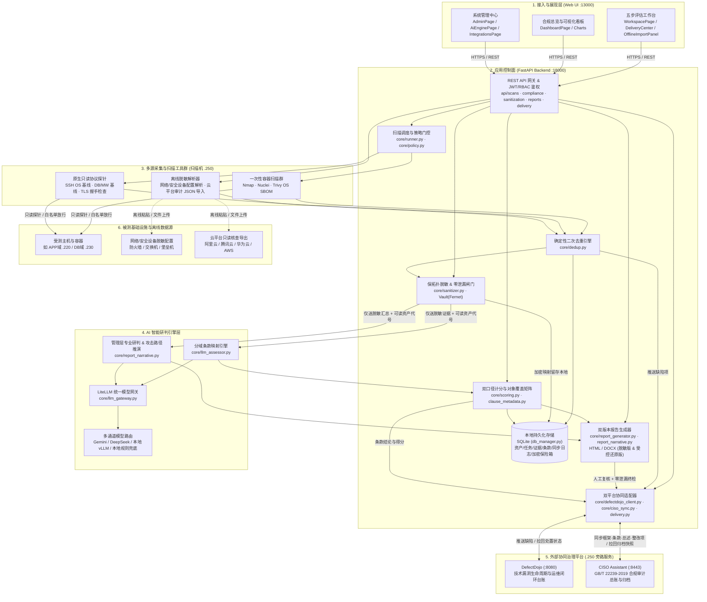
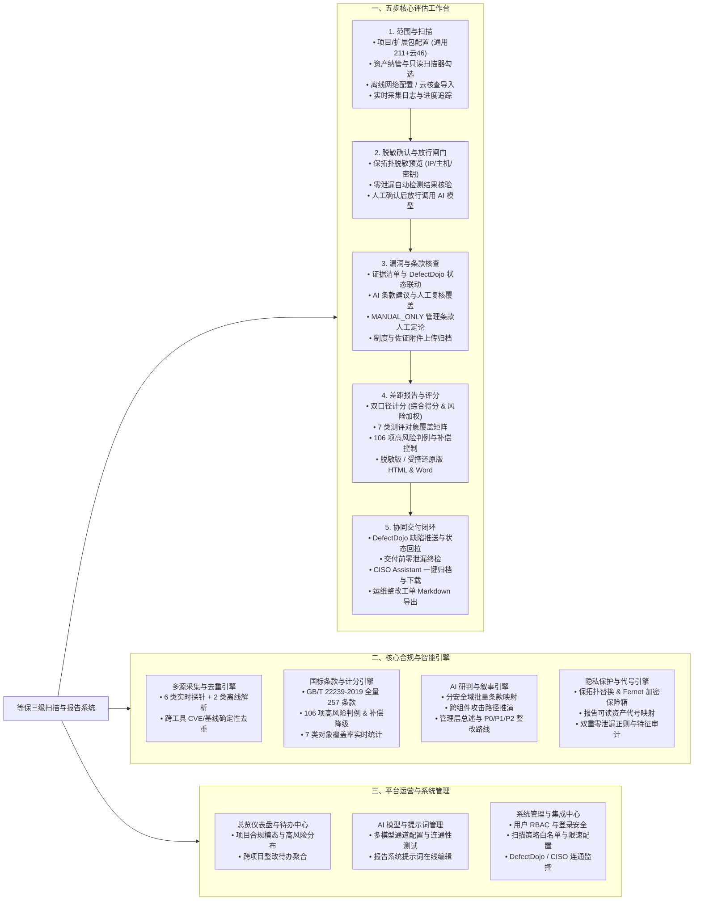
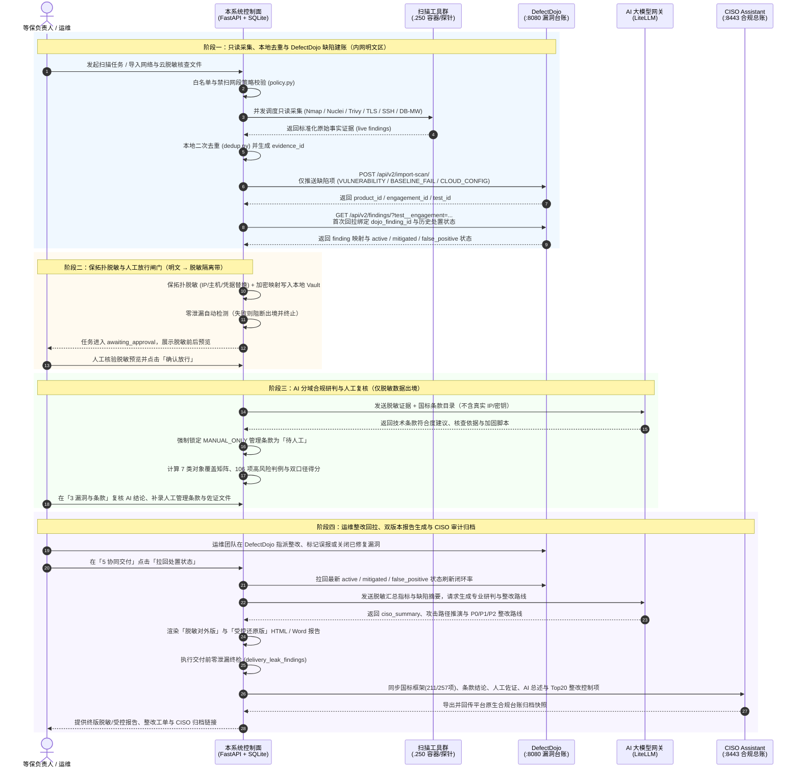

# 等保三级扫描与报告系统 — 系统架构设计文档（ADD）

> **文档版本**：v1.2  
> **适用范围**：等保三级自动化只读采集、保拓扑脱敏、AI 合规研判、差距报告生成与双平台（DefectDojo / CISO Assistant）协同交付系统  
> **参考标准**：GB/T 22239-2019（网络安全等级保护基本要求 · 第三级，通用 211 项 + 云计算扩展 46 项 = 257 项）、T/ISEAA 001-2020（106 项高风险判例与补偿控制规范）

---

## 1. 架构概述与设计原则

### 1.1 系统定位

本系统是一套面向**等保三级预评估、常态化自查与整改闭环**的自动化安全合规中枢平台。它部署在受控扫描控制机（默认 `192.168.1.250`）上，通过统一的业务控制面将**底层只读探针/扫描器、漏洞生命周期管理平台（DefectDojo）、AI 大模型研判引擎（LiteLLM 统一网关）与合规治理台账平台（CISO Assistant）**串联为端到端闭环。

### 1.2 核心架构原则

1. **只读零侵扰采集**：所有主机、数据库、中间件及网络扫描严格遵循 CIDR 白名单与禁扫名单校验；禁止漏洞利用、拒绝服务、模糊测试和外带回连（`-no-interactsh`）；一次性容器具备超时强杀与自动回收机制。
2. **明文与脱敏严格隔离**：原始 IP、主机名、账号与凭据仅留存于内网本地 SQLite 及 Fernet 加密映射保险箱（Vault）；送往外部大模型与 CISO Assistant 的文本统一采用**保拓扑脱敏**与**可读资产代号**（如 `应用域-主机01`、`数据库域-数据库主机01`），并在出境前及交付前执行**双重零泄漏校验**。
3. **AI 辅助研判与人工终审解耦**：技术类条款由 AI 大模型结合脱敏实测证据给出合规建议与加固脚本；`MANUAL_ONLY` 管理制度类条款由代码硬锁定为「待人工」，杜绝模型幻觉编造；任何结论写入 CISO Assistant 前须经人工复核放行。
4. **漏洞级与合规级双平台分层治理**：DefectDojo 聚焦运维视角的**技术漏洞处置（点）**，CISO Assistant 聚焦审计视角的**国标条款达标与治理归档（面）**，由本系统作为唯一中枢双向同步，避免两套外部系统直接耦合。

### 1.3 运行拓扑与关键服务端口

| 节点 / 组件 | 地址 / 端口 | 运行形态 | 核心职责 |
| :--- | :--- | :--- | :--- |
| **前端工作台（Web UI）** | `http://192.168.1.250:13000` | React 18 + Vite + TypeScript（Nginx / 静态托管） | 5 步评估工作台、可视化看板、人工复核与系统管理界面 |
| **后端控制面（API Server）** | `http://127.0.0.1:18000`（经前端反向代理） | Python + FastAPI + SQLite | 扫描调度、二次去重、脱敏与保险箱、AI 路由、双口径计分、报告生成与外部平台同步 |
| **扫描工具群** | 本机 Docker / SSH / Python 进程（`.250`） | 一次性 Docker 容器 + 原生 Python 探针 | 对靶机执行端口、Web、SBOM 漏洞、TLS、OS/DB/MW 基线采集与离线配置解析 |
| **DefectDojo** | `http://192.168.1.250:8080` | Docker Compose 服务栈 | 技术漏洞与配置缺陷生命周期跟踪、误报标注、修复状态闭环 |
| **CISO Assistant** | `https://192.168.1.250:8443` | Docker Compose 服务栈 | GB/T 22239-2019 国标条款库、合规评估总账、整改控制项（Applied Controls）与审计归档 |
| **AI 大模型通道** | 外置 API / 本地 vLLM / 本地规则引擎 | LiteLLM 统一网关 | 条款映射、高风险判例分析、跨组件攻击路径推演与管理层报告撰写 |

---

## 2. 系统架构图（System Architecture）

系统采用六层松耦合架构：展现层、控制面业务层、多源采集执行层、智能研判与报告层、外部协同治理层以及被测目标层。

---

## 3. 功能架构图（Functional Architecture）

系统围绕**“五步评估主线 + 四大底座引擎 + 后台治理中心”**组织功能，覆盖等保三级全量条款核查、风险评估、整改跟踪与审计归档。

---

## 4. 全链路数据流向图（End-to-End Data Flow）

下图展示了数据从被测环境进入系统，经过**本地去重、DefectDojo 缺陷追踪、脱敏闸门、AI 研判、人工复核、报告生成到 CISO Assistant 归档**的完整流转路径，以及严格的**明文/脱敏安全边界**。

---

## 5. 核心组件架构关系深度解析

### 5.1 `.250` 扫描工具群与 DefectDojo 之间的关系（为何“先推送、再拉回”）

**核心定位差异**：
- **扫描工具群（Nmap / Nuclei / Trivy / SSH 基线 / DB-MW 基线 / TLS）** 是一次性**“只读探针”**，只负责采集当前时间点的原始技术事实，自身没有跨轮次的历史记忆，也不具备漏洞指派、误报抑制、风险接受和整改工单闭环能力。
- **DefectDojo** 是**技术漏洞与缺陷生命周期管理系统**，负责将零散的扫描产出沉淀为可长期跟踪的漏洞台账（按 `项目 → Product`、`扫描轮次 → Engagement` 组织）。

**“先推送、再拉回”的双阶段工程逻辑**（对应 `backend/core/runner.py` 与 `backend/core/delivery.py`）：
1. **推送什么（建账而非借壳解析）**：
   - 扫描工具采集完毕后，本系统先在本地完成确定性二次去重（`core/dedup.py`）并入本地 SQLite；
   - 随后通过 `Generic Findings Import` 接口，**只推送需要处置的缺陷类证据**（`IMPORT_TYPES = {"BASELINE_FAIL", "VULNERABILITY", "CLOUD_CONFIG"}`，过滤掉正向通过项 `BASELINE_PASS`），让运维团队直接在 DefectDojo（`:8080`）里开展漏洞认领、误报核销与修复跟踪。
2. **为什么紧接着拉回一次，以及后期还要拉回**：
   - **扫描后立刻首次回拉（`runner.py:_pull_dojo_status`）**：获取 DefectDojo 为每条漏洞分配的持久化 `dojo_finding_id` 并写回本系统数据库，建立两边记录的一一映射（通过 `unique_id_from_tool = evidence_id` 关联）；同时同步 DefectDojo 侧继承的历史去重或处置标记。
   - **整改后在「5 协同交付」再次回拉（`delivery.py:pull_defectdojo`）**：当运维团队在 DefectDojo 中将漏洞标记为已修复（`mitigated`）或误报（`false_positive`）后，本系统回拉最新处置状态，刷新工作台的整改闭环统计，避免已修复或误报项持续拉低评估表现。

---

### 5.2 DefectDojo 与 CISO Assistant 之间的关系

**一句话总结**：两者在架构上**不直接互连**，而是由本系统作为中枢桥接；**DefectDojo 管“技术层漏洞（点）”，CISO Assistant 管“法规层条款（面）”**。

| 对比维度 | DefectDojo（`:8080`） | CISO Assistant（`:8443`） |
| :--- | :--- | :--- |
| **面向角色** | 运维工程师、研发人员、安全运营（SecOps） | 等保负责人、CISO、内审与外部测评机构 |
| **管理粒度** | **资产与漏洞级**（如某主机具体 CVE、MySQL 未开启 SSL、弱口令配置） | **国标条款与治理级**（GB/T 22239-2019 全量 211/257 项条款、管理制度佐证、整改控制项） |
| **解决的问题** | 「某个具体漏洞修好了没有、谁在负责、是不是误报」 | 「整套系统离等保三级达标差多少、每条国标条款的合规佐证是否齐备」 |
| **数据流向位置** | **偏上游**：承接采集与去重后的技术缺陷 | **偏下游**：承接 AI 映射、人工复核及脱敏终检后的合规结论 |
| **本系统映射关系** | `Project → Product`，`Job → Engagement`，`Evidence → Finding` | `Project → Folder/Perimeter`，`Job → Compliance Assessment`，`Clause → Requirement Assessment` |

两者通过本系统的同一个评估批次（`job_id`）实现松耦合关联：**漏洞在 DefectDojo 里销号，条款在 CISO Assistant 里记账，取证、脱敏、映射与出报告在本系统完成。**

---

### 5.3 CISO Assistant 与 AI 大模型之间的关系

**一句话总结**：**AI 大模型是“合规分析与报告撰写引擎（大脑/参谋）”，CISO Assistant 是“持久化合规审计账本（档案室）”**。AI 负责把底层碎片化的技术证据翻译成国标合规语言，CISO Assistant 负责把经人工审核通过的成果按标准框架固化归档。

两者在本系统中遵循**「AI 生产 → 人工复核与零泄漏闸门 → 写入 CISO 归档」**的三段式衔接（对应 `core/llm_assessor.py`、`core/report_narrative.py`、`core/delivery.py`、`core/ciso_sync.py`）：

1. **条款级映射（AI 建议 → 人工确认 → 写入 CISO 条款树）**
   - AI 大模型读取脱敏后的技术证据，按安全域批量推断技术类条款的符合度（符合 / 部分符合 / 不符合）、核查依据与修复脚本；对 `MANUAL_ONLY` 管理类条款则由代码硬锁定为「待人工」，禁止 AI 编造制度结论。
   - 经等保负责人在「3 漏洞与条款」复核确认并补录人工制度材料后，本系统再将最终条款结论批量写入 CISO Assistant 对应的国标节点。
2. **管理层总述与整改控制项（AI 提炼 → 归档至 CISO 顶层）**
   - AI 报告引擎生成的 `ciso_summary`（CISO 评估总述）与 `P0/P1/P2` 分阶段整改路线，会在交付阶段写入 CISO Assistant 评估项目的 `observation` 顶层摘要字段；
   - 不符合与部分符合的关键条款会被自动转化为最多 20 条 **Applied Controls（整改控制项）**，关联到对应条款并在 CISO Assistant 中持续跟踪。
3. **严格的安全隔离边界**
   - AI 大模型**不直接访问 CISO Assistant**；AI 仅接触保拓扑脱敏数据，且在写入 CISO Assistant 之前，本系统强制执行 `delivery_leak_findings` 零泄漏终检，确保归档进 CISO Assistant 的 AI 摘要与中文报告不含任何真实内网 IP 或敏感凭据。

---

## 6. 扫描工具群功能详细说明

本系统的采集层由 **6 类实时只读探针/容器扫描器** 与 **2 类离线脱敏配置解析/导入器** 组成，全面覆盖等保三级 7 类测评对象（网络设备、安全设备、主机操作系统、数据库、中间件、应用系统、云平台）。

| 工具 / 采集器 | 运行方式与实现模块 | 核心检测能力与采集内容 | 安全与只读约束 | 产出证据类型与典型对应条款 |
| :--- | :--- | :--- | :--- | :--- |
| **1. Nmap** | 本机二进制或一次性容器 `instrumentisto/nmap:latest` （`core/container_scanners.py`） | TCP 全连接端口扫描（`-Pn -sT -sV --top-ports 1000`），识别开放端口、运行服务与版本指纹，并为下游 TLS 与 Nuclei 自动构造精准目标列表。 | 强制校验 CIDR 白名单/禁扫名单；禁用 SYN 半开与激进探测；超时（默认 240s）自动强杀容器。 | `PORT_OPEN` / 服务指纹 对应安全区域边界、最小化服务（`8.1.3.x` / `8.1.4.4-a`） |
| **2. Nuclei** | 一次性容器 `projectdiscovery/nuclei:latest` （`core/container_scanners.py`） | 基于 Nmap 发现的 HTTP/HTTPS 端口执行模板化弱点与暴露面扫描，聚焦 `http/misconfiguration/`、`http/exposures/`、`ssl/` 三类非侵入式模板（如缺失安全响应头、敏感路径/管理口暴露、弱配置）。 | 强制排除 `dos, fuzz, intrusive, bruteforce` 标签；禁用外带回连（`-no-interactsh`）；限速（默认 50 req/s）并设预算时间优雅收尾。 | `VULNERABILITY`（含 CVE/CWE、命中路径） 对应入侵防范、安全开发（`8.1.4.4-e`、`8.1.10.5-a`） |
| **3. Trivy OS SBOM** | SSH 采集 RPM 清单 → 生成 CycloneDX SBOM → 一次性容器 `aquasec/trivy:latest` （`core/rpm_sbom.py`、`container_scanners.py`） | 只读拉取目标主机已安装软件包清单（`rpm -qa`），转换为标准 CycloneDX SBOM 后由 Trivy 离线比对漏洞库，精准检出操作系统层 `HIGH` / `CRITICAL` 级已公开 CVE 漏洞，避免对生产机直接发包扫描。 | 仅执行只读软件包列举命令，不触碰目标业务进程；Trivy 在扫描机本地运行，不依赖靶机出网；支持缓存卷复用。 | `VULNERABILITY`（含精确包名、版本、修复版本、CVE） 对应补丁管理与漏洞修补（`8.1.4.4-e`） |
| **4. TLS / SSL 检查器** | 扫描机原生 Python 探针 （`core/collectors/tls_scanner.py`） | 对 Nmap 发现的 HTTPS/SSL 端口发起标准握手检查，核验是否支持过时协议（TLS 1.0 / 1.1）、X.509 证书有效期与过期预警（<30 天）、RSA 密钥强度、弱加密套件及 HSTS 响应头。 | 仅执行单次标准 TLS 握手与 HTTP HEAD 探测，零业务流量干扰。 | `BASELINE_PASS` / `BASELINE_FAIL` 对应安全通信网络、传输保密性（`8.1.2.2-a`） |
| **5. SSH 主机操作系统只读基线** | 扫描机原生 Python Paramiko 只读执行 （`core/collectors/ssh_baseline.py`） | 针对 Rocky Linux / CentOS 等 Linux 主机执行 20+ 项等保核心核查：口令复杂度（`pwquality`/`login.defs`）、登录失败锁定（`pam_faillock`）、空口令与特权账号（UID=0）、SSH 安全配置与会话超时（`TMOUT`）、SELinux、敏感文件权限、`auditd`/`rsyslog` 集中日志留存、`chrony` 时间同步及补丁状态。 | 全部为只读查看命令（`cat`/`grep`/`stat`/`systemctl is-active`）；`dnf` 检查内置 12s 防超时保护；不修改目标任何配置。 | `BASELINE_PASS` / `BASELINE_FAIL` 对应安全计算环境全套主机条款（`8.1.4.1` ~ `8.1.4.5`） |
| **6. 数据库与中间件只读基线** | 扫描机原生 Python Paramiko 只读探测 （`core/collectors/db_mw_baseline.py`） | 自动发现宿主机原生及 Docker/Podman 容器内的 **MySQL/MariaDB、PostgreSQL、Redis、Nginx、Tomcat/HTTPD**；核查监听地址、TLS/SSL 传输加密、空口令/弱鉴别（如 PG `trust`、Redis 未设密码）、审计日志开关、版本号隐藏（`server_tokens`）与危险配置。 | 全程只读查询配置文件与系统状态变量，不写入业务表、不重启服务；自动拆分 `db_baseline` 与 `mw_baseline` 驱动覆盖矩阵。 | `BASELINE_PASS` / `BASELINE_FAIL` 对应数据库与中间件身份鉴别、访问控制、安全审计（`8.1.4.1`~`8.1.4.3`） |
| **7. 网络与安全设备配置解析器** | 离线文本粘贴 / 文件导入解析 （`core/collectors/netdev_config_parser.py`） | 支持华为 VRP/USG、华三 H3C Comware、思科 Cisco IOS/ASA、飞塔 FortiGate 及 Linux `iptables/nftables` 脱敏配置解析，核查默认拒绝策略、宽泛 `Any` 放行、明文 Telnet 管理、会话超时、Syslog 外发、NTP 同步、IPS/AV 及 HA 冗余。 | **零在线接触**核心网络设备，杜绝因扫描导致防火墙/核心交换机性能抖动或误封。 | `BASELINE_PASS` / `BASELINE_FAIL` 填补安全通信网络与区域边界实测（`8.1.2.x`、`8.1.3.x`） |
| **8. 云平台只读核查导入器** | 离线脱敏 JSON 核查结果导入 （`core/collectors/cloud_audit_importer.py`） | 支持阿里云、腾讯云、华为云、AWS 及通用脱敏 JSON 核查清单，自动判定数据境内合规、VPC 隔离、安全组高危端口全网开放（`0.0.0.0/0`）、IAM/RAM MFA 与闲置 AccessKey、云审计日志（ActionTrail/CloudTrail）及 KMS 加密备份策略。 | 离线导入脱敏导出文件，无需在扫描机长期存放高权云账号 AK/SK。 | `CLOUD_CONFIG` / `BASELINE_PASS` 精准覆盖云计算安全扩展要求（`8.2.1` ~ `8.2.4`） |

---

## 7. DefectDojo 功能详细说明

### 7.1 平台定位与核心原生能力

**DefectDojo** 是 OWASP 旗下的开源应用与基础设施漏洞管理平台（ASPM / Vulnerability Management）。在本系统部署于扫描机 `http://192.168.1.250:8080`，承担**技术层漏洞台账与运维整改闭环**角色，其核心原生能力包括：

1. **四级分层漏洞建模**：通过 `Product Type（等保评估） → Product（评估项目） → Engagement（单次扫描周期） → Test / Finding（具体漏洞条目）` 对齐项目管理结构，支持跨多轮扫描的纵向历史对比。
2. **漏洞生命周期状态机**：为每一条漏洞提供完整的处置状态流转，包括 `Active（活跃待修）`、`Verified（已确认）`、`Mitigated（已修复）`、`False Positive（误报）`、`Risk Accepted（风险接受）` 与 `Out of Scope（不在范围）`。
3. **跨轮次去重与回归识别**：对重复出现的同类漏洞支持基于唯一键（`unique_id_from_tool`）与标题/CVE 的匹配，避免运维重复建单；若已修复漏洞在下一轮复测中重新出现，可自动重开（Reopen）。
4. **运维协作与度量看板**：提供按严重级别（Critical / High / Medium / Low）、资产与超期 SLA 统计的漏洞趋势图，支持指派责任人、填写整改备注及对接外部工单系统（如 Jira / GitHub Issues）。

### 7.2 在本系统中的集成机制（`core/defectdojo_client.py` & `core/delivery.py`）

- **自动建账与增量推送**：扫描完成去重后，系统通过 `POST /api/v2/import-scan/`（`scan_type = Generic Findings Import`，`auto_create_context = true`）自动创建或复用对应的 Product 与 Engagement，并将缺陷类证据（`VULNERABILITY`、`BASELINE_FAIL`、`CLOUD_CONFIG`）写入。
- **双向唯一标识映射**：推送时将本系统的 `evidence_id` 写入 DefectDojo 的 `unique_id_from_tool` 字段；拉回时（`GET /api/v2/findings/?test__engagement=<id>`）优先按 `unique_id_from_tool` 精确回写本地证据表的 `dojo_finding_id` 与 `dojo_status`。
- **容错降级机制**：当 DefectDojo 服务不可达或未配置访问令牌时，系统自动降级为 `local_dedup` 模式，仅在本地完成去重与记录同步日志，**不阻塞**后续脱敏、AI 研判与报告生成主流程。

---

## 8. CISO Assistant 功能详细说明

### 8.1 平台定位与核心原生能力

**CISO Assistant** 是一套开源的企业级 **GRC（治理、风险与合规）管理平台**。在本系统部署于扫描机 `https://192.168.1.250:8443`，承担**合规层国标总账、整改治理与审计留痕**角色，其核心原生能力包括：

1. **标准合规框架管理（Frameworks & Libraries）**：支持以 YAML 格式定义与加载任意安全合规标准树（本系统已内置自动生成的 GB/T 22239-2019 第三级通用 211 项框架与含云扩展 257 项框架）。
2. **多维度组织与范围隔离（Folders & Perimeters）**：按组织/项目（`Folder`）与定级系统评估边界（`Perimeter`）隔离不同系统的合规数据，满足多系统并行过等保的管理需求。
3. **条款级合规评估与证据链（Compliance Assessments & Evidences）**：针对国标树中的每一条叶子条款（`Requirement Assessment`），记录正式结论（`compliant` / `partially_compliant` / `non_compliant` / `not_applicable`）、完成状态（`done` / `in_progress`）、详细评语及支撑佐证材料。
4. **整改控制措施管理（Applied Controls）**：将合规差距转化为可执行的整改控制项（按技术类 `technical` 与管理流程类 `process` 分类，标明 P1/P2 优先级），并在多个评估周期中持续复用与追踪整改进度。
5. **原生审计报告与台账导出**：内置合规达标率统计、成熟度雷达图与可下载的审计台账快照，方便应对公安网安部门检查及外部测评机构核验。

### 8.2 在本系统中的集成机制（`core/ciso_sync.py` & `core/ciso_framework.py`）

- **框架按需自动注册（`ensure_framework`）**：交付前自动检测项目启用的扩展包（`GENERAL` 211 项或 `GENERAL + CLOUD` 257 项），若 CISO Assistant 中尚未加载对应版本国标库，自动生成标准化 YAML 并通过 API 上传导入。
- **评估项目与顶层总述同步**：自动创建或复用 `Folder`、`Perimeter` 与按评估批次命名的 `Compliance Assessment`，将 AI 生成的 `ciso_summary` 及分阶段整改路线写入评估项目的 `observation` 字段。
- **全量条款结论与人工佐证回写**：将经人工复核确认的条款最终状态、AI 核查依据及已上传的人工管理制度清单批量回写至对应国标节点。
- **高风险差距转整改控制项（`sync_applied_controls`）**：自动筛选不符合与部分符合条款（优先高风险项），生成最多 20 项结构化整改控制措施（含整改参考脚本）并直接绑定到对应国标条款。
- **归档快照回传**：写入完成后将评估状态置为 `in_review`，拉回 CISO Assistant 生成的原生归档报告并存入本地报告目录，同时在工作台展示直达该评估页面的超链接。

---

## 9. 关键安全、隐私与审计保障设计

| 保障维度 | 落地机制 | 对应核心模块 |
| :--- | :--- | :--- |
| **扫描防误伤** | 强制校验 `whitelist_cidrs` 与 `forbidden_cidrs`（默认禁扫控制机本身 `.250`）；Nuclei 禁高危标签与禁外带；一次性容器超时强制 `docker rm -f`；`dnf` 检查 12 秒防挂死。 | `core/policy.py` `core/container_scanners.py` `core/collectors/ssh_baseline.py` |
| **防数据泄密** | 保拓扑脱敏替换真实 IP/主机名/私钥/口令；明文映射仅用 Fernet 密钥加密存本地 Vault；AI 调用前与 CISO 交付前执行双重零泄漏检测；对外报告仅展示可读资产代号（如 `应用域-主机01`），受控还原版按权限生成。 | `core/sanitizer.py` `core/report_narrative.py` `api/reports.py` |
| **防 AI 幻觉** | 管理制度类条款标注 `MANUAL_ONLY` 由代码硬锁定为「待人工」；技术条款附带确定性证据链与高风险判例校验；模型不可用时支持本地规则引擎降级。 | `core/clause_metadata.py` `core/llm_assessor.py` `core/scoring.py` |
| **时间与审计留痕** | 底层 SQLite 全量记录扫描事件流、同步日志（`sync_records`）与用户操作，统一存储 UTC 时间戳；前端页面、图表与 Word/HTML 报告统一换算为**北京时间（UTC+8）**展示。 | `database/db_manager.py` `frontend/src/time.ts` `core/report_narrative.py` |
