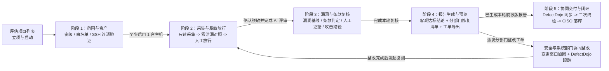
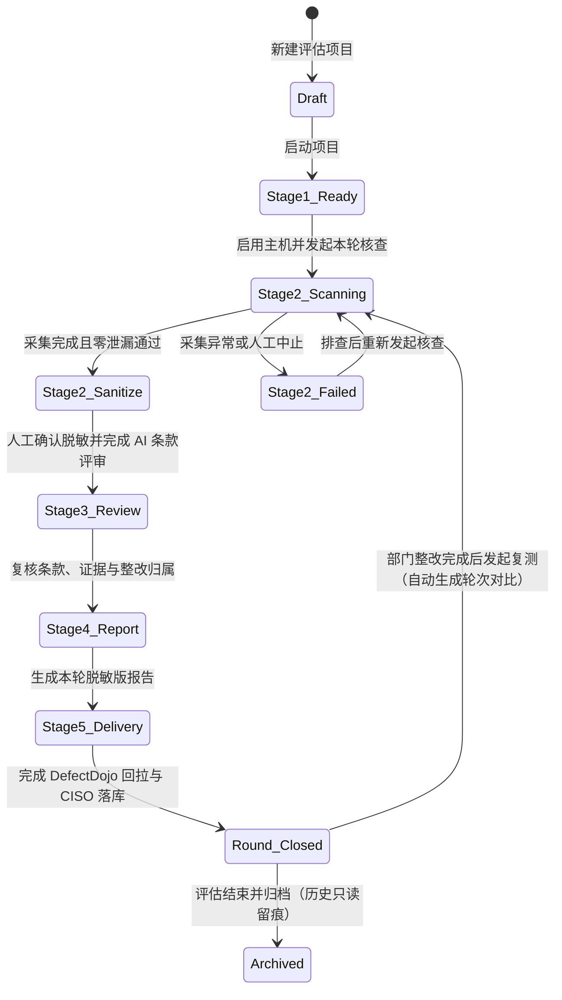

# 等保三级扫描与报告系统 — 生产级 Customer Journey、评估报告与 UI/UX 重构设计方案

本文档面向真实生产环境的落地要求，重新审视并重构「等保三级扫描与报告系统」的产品旅程、评估报告体系与界面交互规范。系统依托「本工作台（采集、脱敏、研判与交付编排）+ DefectDojo 3.5（漏洞处置闭环）+ CISO Assistant v4.3.3（合规台账留档）」三平台协同架构，界面框架、字体与布局参照扫描机上实测的 DefectDojo 3.5 风格，同时保持本系统现有的三套色彩主题不变。

本次重构以**最终交付一份真正有价值的等保三级预评估报告**为核心牵引，倒推全流程的信息架构与交互设计。这份报告必须扎实完成两项生产使命：

1. **完整、清晰地列出所有差距和问题**，按责任部门与修复优先级组织，附上证据溯源、可执行加固步骤、生产变更提醒与验证方式，方便安全部门与系统/运维部门同事直接拆单修复与复核销号。
2. **客观评估当前系统是否达到等保三级要求**，基于 GB/T 22239-2019 与 GB/T 28448-2019 的行业通行口径，给出透明的量化得分、高风险阻断判定、证据完备度说明与十大安全域画像，避免以片面指标误导管理层或测评准备决策。

本阶段仅输出并审阅设计方案，待确认后再按第八章的工程里程碑逐步实施代码改造。

---

## 1. 现状问题深度诊断（代码与实测复核）

结合完整走查截图与现有源码，当前系统距离生产环境高标准存在五类核心短板，这些问题既影响操作体验，也直接削弱了最终报告的业务价值。

### 1.1 现有报告产出尚不足以支撑生产修复与达标决策

核查 `backend/templates/gap_report.html.j2`、`backend/templates/remediation_tickets.md.j2` 与 `backend/api/reports.py` 可以发现，当前报告仍停留在原型演示阶段，距离生产可用差距明显：

- **缺少客观的等保三级达标评估结论**：报告只输出一个「覆盖率」和「高风险未关闭数」，没有百分制综合得分、没有明确的高风险阻断判定口径，也没有按十大安全域统计符合/部分符合/不符合/不适用/待人工分布，管理层看完仍无法回答「当前系统离等保三级达标还差多远、能不能进场测评」。
- **原始技术字段直接暴露，阅读门槛高**：条款差距表直接渲染 `non_compliant`、`partially_compliant`、`pending_manual` 等英文枚举值，没有中文状态映射，也缺少条款名称、所属安全域、控制点与对应证据编号。
- **不便于安全部门与系统部门协同修复**：操作系统高危漏洞在 `api/reports.py` 第 72 行被直接截断为前 40 条（`[:40]`），缺少按软件包合并与完整清单；没有区分系统/主机运维、网络边界、应用研发、数据库中间件和安全管理制度等责任归属；整改工单（`remediation_tickets.md.j2`）仅列出条款与零散脚本，缺少受影响资产、关联 CVE、生产变更影响面、回滚建议和验收命令。
- **未融合人工证据、DefectDojo 处置状态与多轮复测对比**：已在工作台登记的制度与机房证据（`manual_evidence`）、已在 DefectDojo 标为误报或已修复的处置结果，均未进入评估报告；系统也不展示「本轮对比上一轮」的整改收敛情况。

### 1.2 流程碎片化与导航上下文错位

当前工作台（`frontend/src/pages/WorkspacePage.tsx`）把业务拆成「常驻视图（概览、人工证据）」加「8 个顺序页签」，共 10 个独立页面。复核条款与补充制度证据被拆在两行之间，安全人员每处理一条人工条款都要反复跳页，极易丢失上下文。

全局外壳同样存在入口错位：`frontend/src/layout/AppLayout.tsx` 顶栏右侧放着一个脱离项目上下文的全局「发起扫描」按钮，容易在未核对目标主机和白名单的情况下误触扫描；`frontend/src/pages/DashboardPage.tsx` 第 86 行的「同步到 DefectDojo」仍指向 `/integrations`，而 `frontend/src/pages/IntegrationsPage.tsx` 第 69 行还残留旧步骤号「6 协同交付」。

### 1.3 协同交付状态错乱且全流程缺少操作反馈

实测协同交付页面暴露出三处直接影响信任度的缺陷：

1. **按钮点击无加载态与结果回执**：`WorkspacePage.tsx` 中补推 DefectDojo、回拉状态、生成受控还原版、登记人工证据、条款保存等按钮在点击后既无加载锁也无全局提示。例如补推返回「没有需要导入的不符合项」时，页面没有弹出任何提示，用户直觉上会认为按钮点击没有响应。
2. **项目级状态与任务级状态混用导致自相矛盾**：`backend/core/delivery.py` 的 `delivery_snapshot` 从按 `project_id` 存储的 `project_integrations` 读取 `ciso_assessment_id` 和 `dojo_engagement_id`，而从当前 `job_id` 的 `sync_records` 读取 `leak_passed`。开启新一轮任务后，界面会同时显示「还没有做过送入 CISO Assistant 之前的二次脱敏终检」与「评估项目已建立」，且外链错指上一轮评估。
3. **整改工单重复生成**：`backend/api/reports.py` 在生成脱敏版和生成受控还原版时各写入一条 `variant="tickets"` 记录，导致交付卡片出现两个完全相同的 `整改工单` 下载按钮。

### 1.4 问号帮助按钮定位偏差

当前 `?` 图标水平居中排在每个页签右侧，相邻两个页签之间的问号在视觉上很难分辨归属哪一个按钮，同时拉宽导航行导致 1280px 屏幕折行。问号应调整到每个按钮的**右上方角标位置**。

### 1.5 生产环境高可靠性与多部门协同机制尚不完备

当前流程偏重单人单轮扫描体验，对生产环境必需的安全保护（如生产模式默认只读核查、变更窗口提示、运行中任务防并发重复触发与中止能力、导出受控还原版的审计确认与水印、失败局部重试）以及「初测 → 分部门整改 → 复测对比」的多轮闭环支持仍不够系统。

---

## 2. 生产环境核心目标：有价值的评估报告与客观评估体系

在生产环境中，平台的所有采集、脱敏、复核与同步动作，最终都要服务于**评估报告的两大核心价值**。这一章先确立最终交付标准，后续 Customer Journey 与界面布局全部围绕这一标准反推设计。

### 2.1 使命一：客观评估当前系统是否达到等保三级要求

为确保结论客观公允、经得起管理层与外部测评机构质询，系统引入对齐 **GB/T 22239-2019（第三级通用要求 + 云计算安全扩展）** 与 **GB/T 28448-2019** 的**三维达标评估模型**，将「得分」「高风险红线」与「核查完备度」分离计算、联合呈现。

#### A. 规范条款状态集合（全中文呈现，兼容 CISO 映射）

每条等保三级条款（共 101 条）在系统中具备 5 种明确结论，并与 CISO Assistant 状态严格对应：

| 工作台中文状态 | 计分权重 | 适用口径说明 | CISO Assistant 映射 |
| :--- | :--- | :--- | :--- |
| 符合 | 1.0 | 技术证据或人工材料充分，满足等保三级要求 | `compliant` / `done` |
| 部分符合 | 0.5 | 已采取部分防护措施，但存在配置缺口、覆盖不全或弱项 | `partially_compliant` / `done` |
| 不符合 | 0.0 | 缺失关键控制措施，或存在直接违背条款的高危漏洞/配置 | `non_compliant` / `done` |
| 不适用 | 不计入分母 | 经等保负责人填写充分理由确认本系统无对应场景（如未采用无线网络或特定云组件） | `not_applicable` / `done` |
| 待人工 / 未评估 | 见双口径说明 | 尚未取得技术证据或尚未完成现场/制度核查 | `not_assessed` / `in_progress` |

#### B. 双口径量化计分与高风险红线

仅展示一个「覆盖率」容易造成误解。系统在工作台上下文栏与评估报告首页同步输出三组核心客观指标：

1. **核查完备度（证据覆盖率）**：
   $$\text{核查完备度} = \frac{\text{符合} + \text{部分符合} + \text{不符合} + \text{不适用}}{\text{条款总数 (101)}} \times 100\%$$
2. **双口径综合得分（百分制）**：
   - **已核查条款得分**：分母仅包含已完成核查的适用条款（`符合 + 部分符合 + 不符合`），反映目前已核查范围的真实合规水平。
   - **全量保守得分**：分母包含全部适用条款（待人工与未评估条款按 `0` 分计），防止在大量制度与物理条款未核查时给出虚高印象。当核查完备度达到 `100%` 时，两个分数合一。
3. **高风险项阻断红线（参照等保高风险判例原则）**：
   - 凡标记为等保三级高风险项的条款处于「不符合」状态，或存在未闭环的严重漏洞直接利用链，即触发**高风险阻断标记**。只要高风险未闭环数大于 `0`，系统不会给出「具备进场条件」的乐观结论。

#### C. 四级客观评估结论矩阵

评估报告首页以醒目、克制的结论卡片直接给出客观判定，避免模棱两可：

| 评估结论 | 判定条件 | 报告给出的管理层建议 |
| :--- | :--- | :--- |
| **核查未完成（暂无法作出最终达标结论）** | 核查完备度 `< 100%`（存在待人工或未评估条款） | 明确列出已核查项得分与剩余 `N` 条待核查清单，要求安全部门先补齐管理制度、物理环境与现场复核证据，再作最终达标评估 |
| **暂未达到等保三级要求（不建议进场测评）** | 核查完备度 `= 100%`，且全量得分 `< 70` 分，或高风险不符合项 `> 0` | 优先关闭所有 P0 高风险阻断项，完成系统/网络核心整改并执行一轮复测 |
| **基本接近但需整改复测（存在中度差距）** | 核查完备度 `= 100%`，高风险不符合项 `= 0`，全量得分 `70–79` 分 | 按分部门整改工单推进 P1/P2 项收敛，建议将得分提升至 80 分以上再安排测评机构进场 |
| **达到等保三级预评估进场条件（良 / 优良）** | 核查完备度 `= 100%`，高风险不符合项 `= 0`，全量得分 `80–89` 分（良）或 `≥ 90` 分（优良） | 可整理证据包进入正式测评阶段，对少量「部分符合」项在进场前做持续加固 |

#### D. 十大安全域分域画像与证据溯源

报告必须按 GB/T 22239-2019 的十大安全域（安全物理环境、安全通信网络、安全区域边界、安全计算环境、安全管理中心、安全管理制度、安全管理机构、安全管理人员、安全建设管理、安全运维管理）展开分域达标矩阵，每个安全域列出：适用条款数、符合 / 部分符合 / 不符合 / 不适用 / 待人工计数、高风险项数、分域得分与主要短板摘要。每一条条款结论都可向下追溯到具体的扫描证据 ID、人工证据文件名、复核人与复核时间。

> 合规声明保留在报告封面与执行摘要中：本报告为进场前差距预评估与整改依据，正式等级保护测评结论仍以具备资质的测评机构出具的测评报告为准。

---

### 2.2 使命二：面向安全部门与系统部门的可落地差距与修复清单

为了让报告能够直接发给运维、研发和安全同事开展整改，报告正文与配套工单放弃「平铺原始扫描日志」的做法，改按**「优先级 × 责任部门」**结构化归并所有问题。

#### A. 问题优先级分级（四级明确定义）

| 优先级 | 定义口径 | 整改时限建议 | 处理目标 |
| :--- | :--- | :--- | :--- |
| **P0（进场阻断）** | 等保三级高风险条款「不符合」、严重（Critical）可利用漏洞、弱口令或明文管理协议等 | 立即纳入紧急变更（7 日内） | 必须清零后方可进场测评 |
| **P1（高危必改）** | 高危（High）操作系统/组件/Web 漏洞、核心主机安全基线未通过项、TLS 过时协议与弱加密套件 | 纳入近期变更窗口（14 日内） | 批量修复或经安全评审记录补偿措施 |
| **P2（一般改进）** | 「部分符合」条款、中/低危配置项（如缺少 HSTS、日志留存周期不足、自签名证书替换） | 常规迭代窗口（30 日内） | 持续收敛，提升等保综合得分 |
| **P3（待核补证）** | 仍处于「待人工」的管理制度、物理机房、云平台资质与现场访谈类条款 | 进场前材料准备期 | 安全部门牵头收集制度文件与证明材料 |

#### B. 按责任部门分账（避免互相推诿）

系统根据证据来源、条款控制点与资产类型自动归类责任部门（人工复核时可手动调整）：

- **系统与主机运维组**：Rocky/CentOS 操作系统 RPM 安全补丁（按软件源与更新命令聚合，避免 145 条 CVE 逐条刷屏）、SSH 安全配置、口令复杂度与锁定策略、SELinux、auditd 审计、firewalld 防火墙、时间同步。
- **网络与边界安全组**：开放端口最小化（如非必要暴露端口收敛）、安全域访问控制策略、HTTPS/TLS 协议版本与证书治理。
- **应用与研发组**：Nuclei / Web 应用漏洞、接口鉴权与输入校验、HTTP 安全响应头（HSTS 等）、业务日志与会话安全。
- **云平台与基础架构组**：云租户 MFA、安全组 `0.0.0.0/0` 暴露、对象存储公网权限、云审计与云平台等保资质证明。
- **安全管理与合规组**：安全管理制度体系、人员背景与培训记录、物理机房门禁/消防/供电证明、DefectDojo 误报复核与测评进场材料归档。

#### C. 单条修复项的生产级五要素标准

报告与整改工单中的每一项差距或修复任务，统一包含以下五个字段，确保系统部门拿来即可执行变更、安全部门拿来即可验收：

1. **问题定位与溯源**：问题编号、优先级、责任部门、关联等保条款号、受影响资产（脱敏版显示安全域代号，受控还原版显示真实 IP 与端口）、关联 CVE/基线项编号与 DefectDojo Finding ID。
2. **差距现象与风险影响**：说明当前实测配置或漏洞事实，以及在攻击路径中可能导致的横向移动或权限提升风险。
3. **可执行修复方案**：给出聚合后的操作命令或配置片段（例如合并同类 RPM 更新包命令、给出具体 `/etc/ssh/sshd_config` 或 `/etc/pam.d/` 参数），同时附带**生产变更影响面提醒**（如是否需要重启 `sshd`/服务、是否影响现有业务连接）与**配置备份/回滚命令**。
4. **验收核查方法**：给出明确、可重复执行的验证命令或检查标准（例如 `sshd -T | grep permitrootlogin` 预期输出 `no`，或重新触发扫描后对应基线项转为「通过」）。
5. **处置跟踪状态**：同步体现 DefectDojo 中的活跃 / 误报 / 已修复状态与人工复核备注，避免已确认误报的问题重复派单。

#### D. 生产级评估报告标准章节结构（中文 HTML/PDF 同源）

1. **封面与文档控制栏**：项目名称、密级与流转范围（脱敏对外版 / 内部受控还原版）、轮次编号、评估时间、责任人与合规边界声明。
2. **第 1 章 执行摘要与等保三级达标评估结论**：客观结论卡片、双口径百分制得分、核查完备度、高风险红线状态、**较上一轮整改变化对比（初测显示基线，复测显示收敛增量）**。
3. **第 2 章 评估范围、资产清单与核查方法**：白名单与排除网段说明、纳管资产明细、采集工具矩阵与只读安全控制说明。
4. **第 3 章 十大安全域等保三级达标画像**：分域得分矩阵、各域短板总结与高风险项分布。
5. **第 4 章 差距与问题总览（按优先级与责任部门）**：P0 阻断项专表 + 按五大责任部门拆解的聚合问题清单（含完整漏洞附录，不再硬截断为 40 条）+ 跨组件攻击路径分析。
6. **第 5 章 可执行修复指南与验证方案**：面向系统运维与研发同事的聚合加固命令、生产变更注意事项、回滚方案与验收核查命令。
7. **第 6 章 101 条等保三级条款逐项评估明细**：全中文状态、高风险标记、AI 研判与人工复核说明、关联技术证据 ID 与已登记人工证据索引。
8. **第 7 章 人工证据台账、DefectDojo 处置说明与待补清单**：已登记制度/现场证据表、DefectDojo 误报与已修复记录汇总、剩余待人工核查项操作指引。
9. **配套导出物**：**分部门整改工单包**（支持 Markdown 与 CSV 表格格式，便于直接导入企业工单系统或分配给对应小组）+ **CISO Assistant 原生评估报告（`.docx`）**。

---

## 3. 生产环境工程高要求规范

为保证系统可在生产环境长期稳定运行，本次重构将以下五项生产级工程规范作为硬约束纳入前后端设计：

| 维度 | 生产环境高要求 | 本系统具体落地方案 |
| :--- | :--- | :--- |
| **1. 生产业务零中断保护** | 生产主机核查应确保只读采集、限速可控，防止扫描引发业务抖动或误扫非授权资产 | 生产/内网密级默认锁定 `READONLY_AUDIT`；切换 `ACTIVE_SCAN` 须弹出红色二次确认框并记录操作人；白名单强校验并永久排除扫描机 IP；Nuclei 固定排除 `dos / fuzz / intrusive / bruteforce` 并保留速率限制与并发上限；支持运行中任务一键「安全中止」 |
| **2. 多角色权责与全链路审计** | 满足等保「三权分立/最小权限」与操作可追溯要求 | 明确四类职责视图：系统管理员（平台与模型通道管理）、等保负责人/安全部门（全流程核查、条款判定、放行与同步）、整改协作/系统部门（查看分配的差距与修复验证指南，提交整改说明）、只读审计员/管理层（查看脱敏结论与报告）。条款改判、脱敏放行、受控还原版下载、外部平台同步全部落入不可篡改审计日志，还原版导出前弹出审计提示并加注导出人/时间水印 |
| **3. 多轮复测与整改收敛闭环** | 生产等保不是「扫一次就结束」，而是「初测 → 整改 → 复测 → 达标」的持续迭代 | 同一项目下多轮任务自动建立基线对比（Delta Diff）：在概览、阶段 3 复核与阶段 4 报告中自动标出「本轮新修复关闭」「持续未关闭」「本轮新增回归」的漏洞与条款，直观呈现得分上升曲线与高风险清零趋势 |
| **4. 敏感数据双道防泄漏** | 严防生产内网拓扑、IP、口令与个人信息外泄至外部大模型或台账 | 第一道防线：送 AI 评审前执行保拓扑脱敏与零泄漏核验，必须人工对照确认后才触发模型调用；第二道防线：写入 CISO Assistant 前对复核说明、加固脚本、人工备注与脱敏报告执行二次脱敏终检，命中即阻断并定位到具体字段；SSH 凭据与 API Key 全程加密存储，前端永不回显明文 |
| **5. 高可用与容错降级** | 生产网络复杂，单点异常不应导致整轮任务作废或状态错乱 | 同一项目同一时刻防重复发起扫描（互斥锁）；单台主机 SSH 或探测失败仅标记该资产异常，其余主机继续采集；AI 模型调用按域分批、超时可局部重试并保留规则初判；DefectDojo 或 CISO Assistant 暂时不可达时本地证据与中文报告不受影响，支持幂等补推与重试 |

---

## 4. 生产级 Customer Journey 蓝图（5 阶段 + 整改复测双闭环）

### 4.1 三平台职责边界

| 平台 | 核心职责 | 数据边界与协作方式 |
| :--- | :--- | :--- |
| 本系统工作台 | 项目与资产范围管控、只读采集、保拓扑脱敏、AI 条款研判、人工复核与证据台账、客观达标计分、中文差距报告与分部门工单、交付编排 | 生产环境唯一主控入口；按轮次隔离状态，汇总两外平台结果 |
| DefectDojo 3.5 | 漏洞与基线未通过项的持续跟踪、去重、误报评审与修复闭环 | 按项目隔离 Product、按轮次隔离 Engagement；处置状态回拉本系统用于呈现与报告附注，不自动改写等保条款状态 |
| CISO Assistant v4.3.3 | GB/T 22239-2019 合规台账留档、审核流转与原生评估报告导出 | 仅接收通过二次脱敏终检的 101 条条款结论与说明，按轮次建立对应评估记录 |

### 4.2 工作台信息架构收敛（从 10 页碎片到「概览 + 5 阶段」）

参考 DefectDojo 的 `Product -> Engagement -> Findings` 信息层次与合规治理平台最佳实践，原先分散的 10 个视图归并为**项目概览**加 **5 个顺序推进阶段**，既严格保持阶段前置条件，又大幅减少跨页跳转：

| 原页面 | 新归属位置 | 整合原因 |
| :--- | :--- | :--- |
| 概览 | 项目概览（默认视图） | 展示等保三级达标预评结论、双口径得分、十大安全域画像、跨轮次收敛趋势与 5 阶段进度总览 |
| 1 资产白名单 | 阶段 1：范围与资产 | 项目启动后的范围划定：密级、白名单、主机与 SSH 只读连通验证 |
| 2 扫描采集 + 4 脱敏审计 | 阶段 2：采集与脱敏放行 | 扫描结束紧接着零泄漏核对与人工放行，合为同页上下衔接两步，避免采完后再切页找放行按钮 |
| 3 漏洞与基线 + 5 AI 条款映射 + 6 攻击路径 + 人工证据 | 阶段 3：漏洞与条款复核（内置 4 个轻量子视图） | 证据核对、条款改判、不适用说明、人工证据补录与攻击路径审阅属于同一评审环节；在条款抽屉中可直接补录该条款的人工证据，彻底消除来回跳页 |
| 7 报告制品 | 阶段 4：报告生成与预览 | 生成前展示「达标结论与报告质量预检」，支持中文脱敏版、受控还原版（带审计确认）及分部门整改工单（去重唯一）的生成、在线预览与下载 |
| 8 协同交付 | 阶段 5：协同交付与闭环 | 按线性 3 步清单完成 DefectDojo 双向同步、二次脱敏终检与 CISO Assistant 落库、最终双报告归档 |

### 4.3 生产级端到端双闭环流程图



### 4.4 阶段前置条件与状态流转

所有步骤的解锁状态严格绑定当前选中的任务轮次（`job_id`）。点击发起新一轮核查后，页面立刻切换至新创建的进行中任务，阶段 3 至阶段 5 同步置灰锁定，不再沿用上一轮已完成任务的可用状态。



### 4.5 五个阶段的详细交互旅程

#### 阶段 1：范围与资产
- **前置条件**：项目已启动（草稿态在顶部横幅提供「启动项目」主按钮）。
- **核心动作**：设置密级与白名单网段 -> 纳管虚拟机（支持只读核查模式锁）-> 逐台或批量「测试 SSH」。
- **反馈与防错**：测试 SSH 按钮进入加载态，结束后通过 Toast 返回系统版本（如 `Rocky Linux 9.7`）并更新行内连通状态徽标；若白名单误含扫描机 IP，表单行内直接提示拦截。
- **底部推进**：至少启用 1 台主机后，底部高亮主行动条「范围与资产已就绪，前往阶段 2：采集与脱敏放行 ->」。

#### 阶段 2：采集与脱敏放行
- **2A 只读采集面板**：展示启用主机数、模式锁、速率上限与 Nuclei 排除标签；点击「发起本轮核查」后立即创建并切换至新任务、锁定阶段 3–5，展示 4 步结构化进度条（`白名单校验 -> 多源采集 -> 去重与推送 DefectDojo -> 保拓扑脱敏`）、已耗时与「安全中止」按钮，底部可折叠查看明细事件流。
- **2B 脱敏对照与放行面板**：采集到达「待确认脱敏」后自动展开，顶部以绿/红横幅标明零泄漏检查结果；主体左右双栏对照原始摘要（仅授权角色可见）与脱敏送审文本（高亮安全域代号）。点击「确认脱敏结果并开始 AI 条款评审」后进入锁定加载态并展示分域评审进度，完成后弹出 Toast 并自动进入阶段 3。

#### 阶段 3：漏洞与条款复核
- **内置 4 个带计数徽标的轻量子视图**：
  - **3.1 AI 条款映射（默认主视图）**：顶部展示「核查完备度」「双口径得分」「高风险未闭环数」三个实时指标条；支持按十大安全域、自动化级别、当前状态、责任部门、是否高风险筛选；点击条款打开右侧复核抽屉，可查看 AI 依据、关联漏洞与基线证据、复制加固命令与验证命令、设置 5 种状态（符合 / 部分符合 / 不符合 / 不适用 / 待人工）、指派责任部门、填写复核说明，并**直接在抽屉底部补录或查看该条款的人工证据**。
  - **3.2 漏洞与基线**：顶部展示各主机基线「通过 / 未通过」汇总条及较上一轮变化（新修复 / 持续未闭 / 新增）；下方为 DefectDojo 风格可筛选表格（按资产、来源工具、严重度、DefectDojo 状态、关键字筛选），支持查看详情抽屉。
  - **3.3 人工证据台账**：汇总本项目全部制度文件、物理机房记录和云平台资质；支持按条款筛选、新增与删除，并明确提醒勿填入真实内网 IP、口令或个人证件号。
  - **3.4 攻击路径**：以结构化步骤卡展示跨组件利用链与 P0/P1/P2 修复优先级，并可一键跳转到对应阻断条款。
- **底部推进**：提供「前往阶段 4：报告生成与预览 ->」，同时右侧上下文栏实时刷新客观得分与待人工剩余条数。

#### 阶段 4：报告生成与预览
- **顶部「评估质量预检卡」**：在生成报告前，先直观展示本轮将写进报告的核心结论——客观评估结论（如「核查未完成」或「暂未达到等保三级要求」）、双口径得分、P0 阻断项数、待人工剩余条数、按责任部门统计的待修复项数，以及是否存在上一轮对比基线。用户一眼即可判断当前数据是否值得出正式预评报告，或应先回阶段 3 补齐关键人工条款。
- **报告与工单版本卡**：
  - **中文等保预评报告（脱敏对外版）**：主机显示为安全域代号，生成后自动解锁阶段 5。
  - **中文等保预评报告（内部受控还原版）**：保留真实 IP 与端口，仅系统管理员和等保负责人可操作；点击生成或下载时弹出轻量审计确认（记录导出用途与操作人，并提示内部流转范围）。
  - **分部门整改工单（Markdown / CSV）**：同一轮次保持唯一最新版本，按系统运维、网络边界、应用研发、云架构、安全管理分表组织，可直接下载发给各部门领单。
- **在线预览与底部推进**：支持直接在页内或新标签预览中文 HTML 报告；脱敏版生成后，底部主行动条高亮「前往阶段 5：协同交付与闭环 ->」。

#### 阶段 5：协同交付与闭环
详见第六章专项设计，按线性 3 步完成 DefectDojo 双向同步、二次脱敏终检与 CISO Assistant 落库、双报告归档与审计日志留存。

---

## 5. 参考 DefectDojo 3.5 的 UI/UX 框架、字体与布局规范（色彩不变）

### 5.1 色彩锁定原则

参照 DefectDojo 3.5 的核心在于其清晰的企业级空间骨架、字体比例、卡片结构和双栏信息密度，**不改变本系统既有的三套色彩主题**（继续沿用 `frontend/src/styles.css` 中的全部色彩变量）：

- **经典红白（`classic_red`，默认）**：画布 `#f4f5f7`、卡片 `#ffffff`、次底 `#f8f9fb`、品牌红 `#c8102e`、悬停 `#a50d26`、淡红底 `#fdecef`、极细边框 `#e4e7ec`。
- **极地蓝白（`arctic_blue`）**：品牌蓝 `#1d4ed8`、淡蓝底 `#eff6ff`。
- **暗夜深空（`midnight_dark`）**：深色画布 `#0b1220`、卡片 `#111827`、品牌红 `#f04438`。
- **语义与严重度色**：成功 `--ok`、警告 `--warn`、信息 `--info`、危险 `--danger` 与严重/高/中/低危徽标色值保持一致。

### 5.2 字体与排版层级（对照 DefectDojo 3.5 实测）

- **主字体栈**：`"Inter", "PingFang SC", "Microsoft YaHei", system-ui, -apple-system, "Segoe UI", sans-serif`
- **等宽字体栈**：`"JetBrains Mono", "Cascadia Code", "Consolas", monospace`（用于条款编号、CVE、任务 ID、白名单 CIDR 与加固/验证命令）
- **数值对齐**：全部得分、百分比、漏洞计数、表格数字与时间戳启用 `font-variant-numeric: tabular-nums`
- **字号与间距规范**：
  - 页面主标题（`h1`）：`20px`，`font-weight: 700`，`line-height: 1.35`
  - Panel 面板标题（`h2`）：`15px`，`font-weight: 600`，配 `16px` 线框图标
  - 正文与表格单元格：`14px`，`line-height: 1.55`
  - 表格表头（`th`）：`12px`，`font-weight: 600`，`padding: 10px 14px`
  - 面包屑、标签徽标与辅助提示：`12px`–`13px`

### 5.3 全局外壳框架（`224px` 窄侧栏 + `56px` 紧凑顶栏）

| 区域 | 当前实现 | DefectDojo 3.5 参考特征 | 本系统重构方案 |
| :--- | :--- | :--- | :--- |
| 左侧导航栏 | `240px`，分组标题和边框偏重 | `224px` 固定窄栏，干净的单列「图标 + 菜单名」 | 收窄至 `224px`；保留「全局大盘 / 评估项目 / 待办与审批 / 等保条款库 / AI 评审引擎 / 集成与引擎 / 系统管理」7 项清晰入口；底部放置三主题切换与退出登录 |
| 顶部导航栏 | `68px` 以上，带厚重边框的当前位置方框 + 全局「发起扫描」按钮 | `56px` 紧凑顶栏，右侧为搜索框 + 告警角标铃铛 + 用户菜单 | 高度压缩为 `56px`、`1px` 细底线；**移除脱离项目上下文的全局「发起扫描」按钮**和厚重当前位置盒子；右侧依次为「条款库搜索框」「待办数量角标按钮（直达待办与审批）」「用户角色菜单」 |
| 面包屑 | 放在顶栏左上角，只有一级栏目名 | 置于主内容区标题下方，呈轻量层级路径 | 下沉至主内容区顶部（如 `评估项目 / Stage-1 等保三级扫描与差距报告 / 阶段 3：漏洞与条款复核`） |

### 5.4 仪表盘 KPI 卡片（仿 DefectDojo 左侧彩条结构）

```text
+---------------------------------------------------+
|▌  (图标)   68.5 分  [暂未达到进场条件]              |
|▌           等保三级预评估得分（已核查口径）          |
|▌           核查完备度 42% · 高风险未闭环 16 项       |
|---------------------------------------------------|
|  查看十大安全域达标详情                         ->  |
+---------------------------------------------------+
```

大盘顶部 4 张 KPI 卡片分别聚焦管理层最关心的四个维度：**等保预评得分与结论**、**高风险阻断项数**、**本轮已归集发现（含严重/高危）**、**待确认脱敏与待人工条款**。每张卡片底部独立浅底跳转栏直达当前项目的准确阶段，彻底修复原先错误跳转到 `/integrations` 的问题。

### 5.5 项目工作台 8:4 主副双栏框架（仿 DefectDojo Engagement 详情页）

```text
+=======================================================================================+
| Stage-1 等保三级扫描与差距报告                         [轮次: 2026-11-20 11:56 已完成 v] |
| ------------------------------------------------------------------------------------- |
| [概览]?  [1 范围与资产 1]?  [2 采集与脱敏]?  [3 漏洞与条款 170]?  [4 报告]?  [5 协同交付]? |
| ===================================================================================== |
| 评估项目 / Stage-1 / 阶段 3：漏洞与条款复核                                               |
+---------------------------------------------------------------------------------------+
| +--------------------------------------------------+  +-----------------------------+ |
| | [图标] Panel 标题          [筛选] [次操作] [主操作] |  | (i) 本轮等保预评上下文        | |
| |--------------------------------------------------|  |-----------------------------| |
| |                                                  |  | 预评结论   暂未达标(高风险)  | |
| |              主内容区域（表格/表单/对照）           |  | 综合得分   68.5分(保守 28.5) | |
| |                                                  |  | 核查完备度 42% (42/101)     | |
| |                                                  |  | 高风险未闭 16 项 (较上轮 -2) | |
| |                                                  |  | 项目状态   已启动 · L1_TEST | |
| |                                                  |  | 启用主机   1 台 (SSH 连通)   | |
| |                                                  |  | 当前任务   job_986e07df     | |
| |                                                  |  | Dojo 周期  #4 (活跃 170)    | |
| |                                                  |  | CISO 台账  本轮待终检同步    | |
| |--------------------------------------------------|  |-----------------------------| |
| | [上一步]                  [前往阶段 4：报告生成 ->] |  | 建议下一步                   | |
| +--------------------------------------------------+  | 完成剩余高风险复核并生成报告  | |
|                                                       | [ 前往阶段 4：报告生成 -> ]  | |
|                                                       +-----------------------------+ |
+=======================================================================================+
```

- **左侧主区（`minmax(0, 1fr)`）**：统一使用 DefectDojo 风格 Panel（图标标题栏 + 摘要统计 + 右上角紧凑操作区 + 表格/表单 + 底部推进条）。
- **右侧固定上下文侧栏（`300px`，`position: sticky; top: 72px`；窄屏 `< 1100px` 折至上方可展开摘要条）**：将「当前系统是否达到等保三级要求」的核心数字与本轮三平台联动状态常驻在用户视线内，无论切到哪一阶段，都能一眼确认当前轮次、距离达标的差距与下一步推荐操作。

---

## 6. 关键交互组件规范与协同交付专项重构

### 6.1 问号固定在按钮右上方角标位置

彻底修正问号夹在相邻按钮中间、归属模糊的问题：

```text
                       (?)  <-- 按钮右上角角标 (position: absolute; top: -7px; right: -7px)
  +---------------------+
  | 2 采集与脱敏         |
  +---------------------+
```

- **结构与定位**：外层 `.stage-tab-wrap` 设为 `position: relative; display: inline-flex;`，主按钮为独立 `<button role="tab">`，问号为独立 `<button type="button" className="stage-help-badge">`，绝对定位在 `top: -7px; right: -7px`，直径 `18px` 圆形白底细边；页签栏设置 `gap: 14px` 与 `padding-top: 8px`，使角标与右侧按钮保持清晰间距。
- **交互规则**：即使阶段按钮处于未解锁灰色禁用态，右上角问号仍清晰可点；点击后在按钮下方展开 `300px` 说明浮层，固定呈现三项信息——**本阶段做什么**、**解锁前置条件与当前状态**、**预期产出物**；最右侧页签自动右对齐防溢出，点击外部或按 `Esc` 关闭。

### 6.2 全流程按钮点击反馈契约（零静默操作）

所有写操作、采集触发、文件导出与外部平台同步统一接入 `ToastProvider` + `ActionButton` 契约，保证点击后 `100ms` 内产生视觉响应，结束后给出明确结果：

| 操作档位 | 典型动作 | 按钮态反馈 | 结果回执（Toast / 面板） | 生产级防误与异常规范 |
| :--- | :--- | :--- | :--- | :--- |
| **瞬时操作（< 1s）** | 复制加固/验证命令、展开日志、打开外链 | 短时变为「已复制」或立即展开 | 轻量信息 Toast（2.5 秒自动消失） | 剪贴板异常时弹出明确提示 |
| **短耗时异步（1s–10s）** | 测试 SSH、保存主机/白名单、保存条款复核、登记人工证据、生成报告、下载文件、补推/回拉 DefectDojo、启动/归档项目 | 立即禁用 + 旋转加载图标 + 进行中文案（如「正在回拉状态…」） | 右上角弹出带语义色的 Toast（成功绿 / 无新增蓝 / 警告橙 / 失败红），包含「动作 + 结果 + 数量」，例如：`已补推 DefectDojo：本次新增 0 条，当前周期共关联 170 条` | 每次请求完成后均给出明确回执，避免静默刷新；无新增项明确告知「无新增」，后端报错透出可读原因；受控还原版下载与归档动作增加确认弹窗 |
| **长耗时任务（> 10s）** | 发起本轮核查、确认脱敏并开始 AI 评审、终检并同步到 CISO 生成最终报告 | 按钮防重锁定 + 加载态 + 预计耗时提示 | 面板内联展示分阶段进度条；采集过程提供「安全中止」按钮；完成后弹出持久 Toast 并引导进入下一阶段 | 轮询超时或 502 异常时释放锁定、保留已执行日志并提供「一键重试」 |

### 6.3 阶段 5「协同交付」专项重构

#### A. 底层数据口径修正
1. **按 `job_id` 隔离外部平台映射**：每轮任务独立记录本轮的 `dojo_engagement_id`、`dojo_url`、`ciso_assessment_id`、`ciso_url` 与终检结果，彻底消除「本轮尚未做终检」与「评估项目已建立」并存的矛盾文案，确保外链精确打开本轮对应的 DefectDojo Engagement 与 CISO Assessment。
2. **报告与整改工单按 `(job_id, variant)` 唯一化**：同一任务重新生成脱敏版、受控还原版、整改工单或 CISO 原生报告时，覆盖更新对应版本记录并刷新生成时间，彻底消除重复的 `tickets.md` 按钮。
3. **DefectDojo 处置回拉与报告联动**：回拉得到的误报与已修复计数同步展现在阶段 3 漏洞表、右侧上下文栏与阶段 4 报告附注中，同时保持「漏洞关闭不自动改写等保条款」的合规审计边界。

#### B. 线性 3 步协同交付清单（整页同一时刻仅突出一个主红按钮）

```text
+-------------------------------------------------------------------------+
| [步骤 1] DefectDojo 漏洞处置同步                        [状态: 已同步 170条] |
| ----------------------------------------------------------------------- |
| 产品: Stage-1 等保三级扫描与差距报告    本轮周期: job_986e07df-2026-11-20  |
| 处置统计: 已关联 170  |  活跃 170  |  误报 0  |  已修复 0                  |
|                                                                         |
| [从 DefectDojo 回拉状态]  [补推遗漏项]  [打开本轮 DefectDojo ->]           |
+-------------------------------------------------------------------------+

+-------------------------------------------------------------------------+
| [步骤 2] 二次脱敏终检与 CISO Assistant 合规落库           [状态: 本轮待执行] |
| ----------------------------------------------------------------------- |
| 终检扫描项: 条款复核说明 / 加固命令 / 人工证据备注 / 脱敏版报告全文          |
| 同步口径预览: 符合 12 · 部分符合 8 · 不符合 10 · 不适用 2 · 待人工 69       |
| 提示: 69 条待人工条款写入 CISO 后将记为未评估(进行中)，复核后可再次同步更新  |
|                                                                         |
| [★ 执行二次脱敏终检并写入 CISO 生成最终报告]    [打开本轮 CISO (未建置灰)]   |
+-------------------------------------------------------------------------+

+-------------------------------------------------------------------------+
| [步骤 3] 最终双报告与分部门工单归档                      [状态: 已就绪 3/4] |
| ----------------------------------------------------------------------- |
|  中文等保预评报告（脱敏对外版）   job_986e07df-masked.html    [预览] [下载] |
|  中文等保预评报告（内部还原版）   job_986e07df-restored.html  [审计下载]    |
|  分部门整改工单（系统/网络/应用） job_986e07df-tickets.md/.csv [下载]       |
|  CISO Assistant 原生评估报告     完成步骤 2 后自动生成         [待生成]     |
+-------------------------------------------------------------------------+

> 展开本轮同步审计日志（共 3 条，最新：12:05 defectdojo_push 成功 · 无新增项）
```

- 当二次脱敏终检发现未脱敏内容时，步骤 2 卡片内直接展示命中片段与归属位置（如「人工证据 8.1.6.1-a 备注包含内网地址」），并提供一键跳转至阶段 3 对应位置修改的链接，形成可闭环的纠错体验。

---

## 7. 核心页面改造与组件架构清单

### 7.1 页面改造对照

| 页面 / 路由 | 核心改造内容 | 涉及现有文件 |
| :--- | :--- | :--- |
| 全局外壳与样式 | `224px` 侧栏 + `56px` 顶栏；移除顶栏全局发起扫描；新增待办角标、Toast 容器、下沉面包屑与 `Inter` 字体栈（保留三套配色） | `frontend/src/layout/AppLayout.tsx`、`frontend/src/styles.css` |
| 全局大盘 `/dashboard` | 改用左侧彩条 KPI 卡展示客观预评得分、高风险数、发现数与待办；修正旧跳转链接直达项目具体阶段 | `frontend/src/pages/DashboardPage.tsx` |
| 评估项目 `/projects` | 卡片展示项目客观预评结论胶囊、当前阶段与最新轮次状态；全操作接入统一 Toast | `frontend/src/pages/ProjectsPage.tsx` |
| 项目工作台 `/projects/:id` | 重构为「项目概览 + 5 阶段」+ 右上角问号角标 + 8:4 主副双栏（右侧固定上下文与预评得分栏）+ 底部阶段推进条 | `frontend/src/pages/WorkspacePage.tsx`（拆分为 `workspace/` 子模块） |
| 待办与审批 `/todos` | 跳转路径适配新 5 阶段参数；支持按项目、优先级过滤待确认脱敏与待人工条款 | `frontend/src/pages/TodosPage.tsx` |
| 集成与引擎 `/integrations` | 修正旧步骤号文案为「阶段 5：协同交付」；连通探测与 JSON 导入接入统一 loading 与 Toast | `frontend/src/pages/IntegrationsPage.tsx` |

### 7.2 建议抽离的前端通用组件

继续使用现有 React 18 + Vite + TypeScript 技术栈，不引入重型 UI 组件库，抽离轻量可复用组件以提升生产可维护性：

- `frontend/src/components/ToastProvider.tsx`：全局右上角语义通知栈。
- `frontend/src/components/ActionButton.tsx`：带防重锁、加载图标与统一异常捕获的异步按钮。
- `frontend/src/components/ConfirmModal.tsx`：用于生产高危动作（切换主动扫描、受控还原版审计导出、项目归档、中止任务）的二次确认弹窗。
- `frontend/src/components/StageTabs.tsx`：DefectDojo 风格水平阶段导航，支持计数徽标、禁用态与右上角 `?` 角标浮层。
- `frontend/src/components/Panel.tsx`：统一 DefectDojo 风格面板容器（图标标题栏 + 操作区 + 内容区 + 底部推进条）。
- `frontend/src/components/ContextSidebar.tsx`：右侧 `300px` 固定上下文摘要栏（客观预评结论、双口径得分、较上轮变化、三平台同步状态与建议下一步按钮）。
- `frontend/src/pages/workspace/`：按阶段拆分为 `OverviewPanel.tsx`、`AssetsStage.tsx`、`CollectSanitizeStage.tsx`、`ReviewStage.tsx`、`ReportsStage.tsx`、`DeliveryStage.tsx`。

### 7.3 与现有 `UI_UX设计规范.md` 的关系

现有 `UI_UX设计规范.md` 的三套色彩 Token、极细边框网格与报表视觉同源原则继续保留；本方案在其基础上补充了生产级评估报告与计分标准、DefectDojo 3.5 空间框架、5 阶段 Customer Journey、右上角问号角标和全流程按钮反馈契约。工程落地完成后，将同步更新 `UI_UX设计规范.md` 与 `使用说明.md`。

---

## 8. 生产级工程落地路线图（待审阅确认后启动）

为确保每次发布均可独立回归且不影响线上既有数据，建议按 5 个里程碑顺序交付：

### 里程碑 1：客观评估计分引擎、跨轮次对比与后端契约修正
- 新增 `backend/core/scoring.py`：实现 GB/T 22239-2019 双口径百分制得分、高风险红线判定、四级客观评估结论、十大安全域分域画像、责任部门自动归类以及多轮任务 Delta Diff（较上一轮新修复 / 未关闭 / 新增）。
- 扩展 `backend/database/schema.sql` 与 `backend/database/db_manager.py`：按 `job_id` 隔离保存 DefectDojo 与 CISO 映射（消除项目级与任务级状态串台）；报告与工单按 `(job_id, variant)` 唯一更新（消除重复工单）；支持条款「不适用（`not_applicable`）」状态与责任部门字段；记录受控还原版导出审计日志；支持同项目防并发扫描互斥与任务安全中止标记。
- 更新 `backend/core/workflow.py`（5 阶段前置条件与旧 URL 兼容映射）及 `backend/core/delivery.py`（返回结构化反馈摘要）。
- 完善 `backend/tests/test_gates.py` 单元测试覆盖计分口径、高风险阻断、轮次对比、交付隔离与报告去重。

### 里程碑 2：生产级中文评估报告与分部门整改工单重构
- 升级 `backend/api/reports.py`、`backend/core/report_generator.py`、`backend/templates/gap_report.html.j2` 与 `backend/templates/remediation_tickets.md.j2`：
  - 落地第二章定义的 7 章标准报告结构，全中文状态映射，完整呈现客观达标结论、十大安全域画像、跨轮次收敛对比、按责任部门与优先级聚合的完整问题清单（含 RPM 补丁聚合、变更影响面、回滚与验收命令）、101 条条款溯源明细、人工证据台账与 DefectDojo 处置附注。
  - 新增分部门整改工单导出（Markdown 与 CSV 双格式），还原版报告增加导出人、时间与内部受控水印。

### 里程碑 3：DefectDojo 风格全局外壳与反馈基础设施
- 实现 `ToastProvider`、`ActionButton`、`ConfirmModal`、`Panel` 与 `StageTabs`（含右上角 `?` 角标）。
- 重构 `AppLayout.tsx` 与 `styles.css`（`224px` 侧栏、`56px` 顶栏、移除全局发起扫描、待办角标、`Inter` 字体栈、保留三套色彩）。
- 升级 `DashboardPage.tsx`（左侧彩条 KPI 卡 + 修正跳转）、`ProjectsPage.tsx`、`TodosPage.tsx` 与 `IntegrationsPage.tsx`。

### 里程碑 4：项目工作台 8:4 双栏与 5 阶段重构
- 按阶段拆分并重构 `WorkspacePage.tsx`：上线右侧 `300px` 固定上下文与客观预评得分栏、阶段 2 实时采集进度与安全中止、阶段 3 四子视图与抽屉内就地登记人工证据、阶段 4 报告质量预检与在线预览、阶段 5 线性三步协同交付清单与全按钮 Toast 反馈。

### 里程碑 5：生产级端到端验收、部署与文档同步
- 运行全套后端单元测试与前端类型/构建检查，部署至扫描机 `192.168.1.250`。
- 在浏览器中完整走查「初测 → 复核 → 报告与分部门工单导出 → DefectDojo 回拉 → CISO 落库 → 复测对比」全流程，逐一核验右上角问号、按钮加载与 Toast 回执、客观达标得分计算、中文报告完整度以及三套主题显示效果。
- 同步更新 `使用说明.md` 与 `UI_UX设计规范.md`。

---

请审阅本版设计方案。若你对**等保三级双口径计分与四级客观结论标准**、**分部门修复清单五要素**、**5 阶段双闭环旅程**或 **DefectDojo 风格 8:4 布局**有进一步补充或调整意见，我可以继续修订文档；确认后即可按里程碑 1 开始工程落地。
