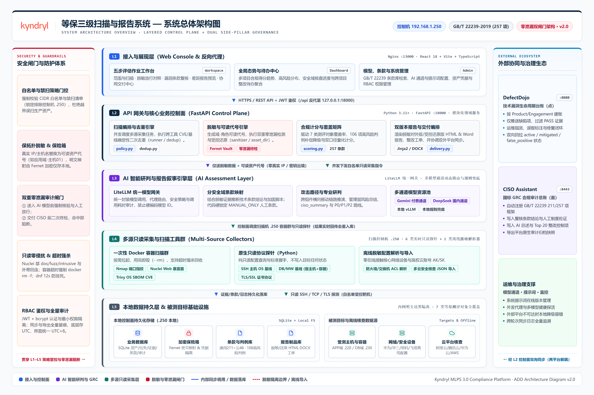
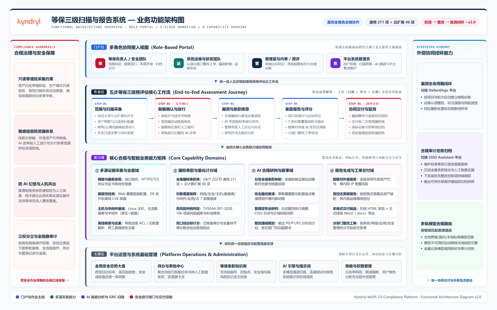
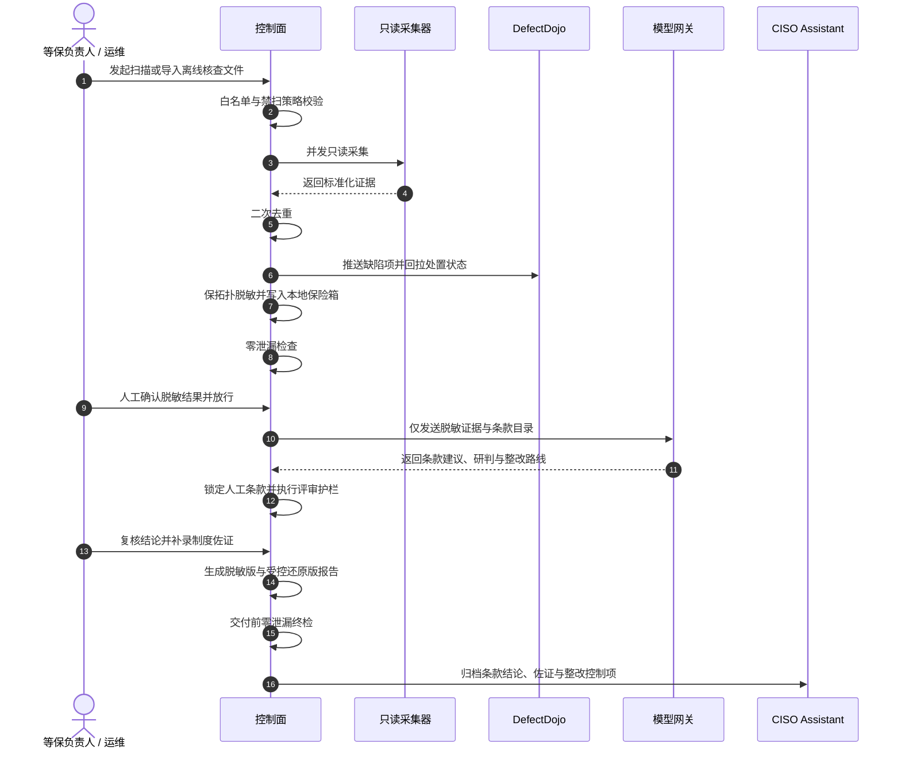

# 等保三级扫描与报告系统

MLPS 3.0 Compliance Scanning & Reporting Platform

面向企业信息安全、运维与合规团队的等保三级预评估、常态化自查与整改闭环平台。系统只做只读采集，凭据通过环境变量注入，不会写入代码仓库。

## 本地启动前

1. 复制环境变量模板，并只在本机 `.env` 中填写密钥与口令：

```powershell
Copy-Item .env.example .env
```

2. 复制扫描范围模板，并只在本机 `config/targets.yaml` 中填写真实资产：

```powershell
Copy-Item config\targets.example.yaml config\targets.yaml
```

`.env` 与 `config/targets.yaml` 已加入 `.gitignore`，不会进入 GitHub。

## 系统架构图



中央五层依次为接入展现层、业务控制面、AI 智能研判层、多源只读采集层、本地数据与被测基础设施。左侧纵柱负责白名单、脱敏保险箱、零泄漏闸门和权限审计；右侧纵柱对接 DefectDojo 与 CISO Assistant。

## 业务功能架构图



## 控制流图



---

## 一、项目描述（中文）

**等保三级扫描与报告系统** 是面向企业信息安全团队、运维团队与合规审计部门的智能体驱动网络安全等级保护（GB/T 22239-2019 第三级）预评估、常态化自查与整改闭环平台。传统等保迎检准备过程中，主机基线、数据库/中间件配置、系统漏洞、传输加密与网络边界核查高度依赖分散工具与人工汇总，不仅耗时漫长、口径难以统一，而且容易出现只抽样单机却误以为全局覆盖的“合规盲区”；同时，若直接将原始内网拓扑、资产地址与配置明细送入外部大模型进行分析，又会带来敏感数据外泄、模型幻觉误判及无据可查等合规风险。针对这些痛点，本系统将只读多源采集、保拓扑脱敏与零泄漏门禁、国标条款智能映射与硬护栏、双口径量化评分，以及 DefectDojo 与 CISO Assistant 双平台协同融为一体，打通从多维安全取证到差距研判、分部门整改与正式审计归档的端到端闭环。

### 核心架构、流程与 AI 技术

- **分层协同与双纵柱治理架构**：采用「五层水平业务栈（接入展现层、业务控制面、AI 智能研判层、多源只读采集层、本地数据与目标基础设施层）+ 左侧全链路安全闸门柱 + 右侧外部生态协同柱」的企业级架构，全链路内置权限控制、操作留痕与模型调用审计。
- **人机协同五步受控流程**：围绕「范围与只读扫描 → 脱敏核验与人工放行 → 漏洞与条款核查 → 差距报告与量化评分 → 协同交付与复测」串联全周期，在数据出境、人工条款复核与合规台账交付等关键节点强制人工审批。
- **统一模型网关、保拓扑脱敏与硬规则护栏**：按任务密级与复杂度调度模型通道，并支持离线规则降级。真实地址、主机名与凭据加密留存在本地保险箱，对外使用可读资产代号；出境前和交付前执行零泄漏检查。人工管理类条款锁定为待人工，已有高危实测证据的条款不能被模型改判为符合或未评估。
- **漏洞级与合规级双平台解耦集成**：DefectDojo 跟踪技术漏洞与配置缺陷的生命周期；CISO Assistant 归档国标条款、人工佐证和整改控制项。本系统作为唯一中枢双向同步。

### 主要场景

- **零侵扰多源只读安全取证**：在白名单、禁扫名单和只读策略下完成端口发现、非侵入式 Web 核查、保留软件包版本精度的漏洞比对、传输加密检测，以及主机、数据库和中间件基线核查，并支持离线导入网络设备与云平台核查结果。
- **国标条款智能映射与高风险判例量化**：内置 GB/T 22239-2019 第三级条款库（通用要求与云计算扩展）和 T/ISEAA 001-2020 高风险判例及补偿控制规则，输出对象覆盖矩阵、风险加权双口径得分、证据驱动攻击路径和可回滚加固脚本。
- **双版本专业报告与分部门工单交付**：按权限生成脱敏对外版和受控还原版 HTML / PDF / Word 报告，以及分部门整改工单。
- **跨平台整改闭环与持续复测**：推送缺陷、回拉处置状态、补录线下证据，并通过交付前终检后归档到合规台账。

### 主要优点

- 将分散巡检、条款对标和报告编制压缩到一次受控自动化流程中。
- 用覆盖矩阵、版本精确比对和评审护栏降低漏报、误报、敏感信息外泄和模型误判。
- 评分口径对齐高风险判例、补偿降级和风险加权。
- 衔接现有漏洞管理和合规台账，而不是另起一套无法闭环的扫描结果。

### 当前限制与后续方向

- 深度自动采集目前以 Linux 和常见开源数据库、中间件为主；Windows、部分国产化组件和专用网络设备仍可先用离线配置导入。管理制度、物理环境和人员应急类条款需要线下核查。
- 后续将扩展无代理采集范围、应用与云原生安全核查，以及制度文档辅助初审。

### 适用人群

等保项目负责人、信息安全经理、安全运营工程师、系统与数据库运维工程师、应用研发负责人、内审与合规人员及企业管理层。

---

## Project Description (English)

**MLPS 3.0 Compliance Scanning & Reporting Platform** is an AI-assisted pre-assessment, continuous self-audit, and remediation platform for enterprise security, operations, and compliance teams working toward GB/T 22239-2019 Level 3. Traditional preparation scatters host baselines, database and middleware checks, vulnerability scans, TLS inspections, and boundary reviews across disconnected tools. Single-host sampling can also hide coverage gaps. Sending raw topology and configuration details to an external model adds data-exposure and hallucination risk. This platform combines read-only collection, topology-preserving sanitization, rule-guarded clause assessment, dual-metric scoring, and decoupled DefectDojo plus CISO Assistant integration.

### Architecture, workflow, and AI controls

- **Layered architecture with two governance pillars**: presentation, business control plane, AI assessment, read-only collectors, and local data plus target infrastructure; one pillar enforces allowlists, vault storage, zero-leakage gates, and audit, while the other connects vulnerability and compliance platforms.
- **Five-stage human approval flow**: scope and scan, sanitization release, vulnerability and clause review, gap scoring, then delivery and retest.
- **Model gateway and hard guardrails**: credentials stay in environment variables and the local encrypted vault. Manual governance clauses cannot be auto-passed, and empirical high-severity findings cannot be overwritten into a compliant or unassessed result.
- **Two-platform separation**: DefectDojo tracks technical findings; CISO Assistant archives control conclusions, evidence, and remediation items.

### Main scenarios

- Read-only multi-source evidence collection and offline imports.
- Mapping to the Level 3 catalog and T/ISEAA 001-2020 high-risk precedents, including coverage, weighted scores, attack paths, and rollback-safe hardening guidance.
- Sanitized and controlled report editions in HTML, PDF, and Word, plus departmental tickets.
- Push, pull, retest, and audit archival.

### Benefits, limits, and audience

The workflow replaces fragmented manual preparation with one controlled loop, while making blind spots and model boundaries explicit. Deep automated baselines currently focus on Linux and common open-source data services; other platforms can enter through offline evidence, and organizational or physical controls remain manual. The audience includes compliance leads, security managers, operations engineers, system and database administrators, engineering leads, auditors, and executives.
