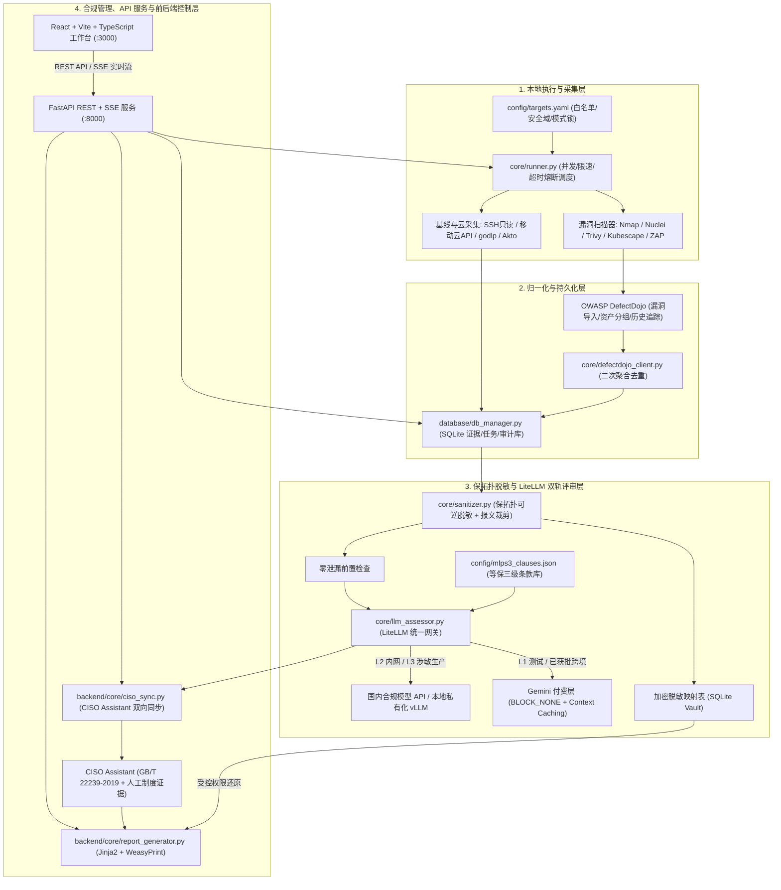
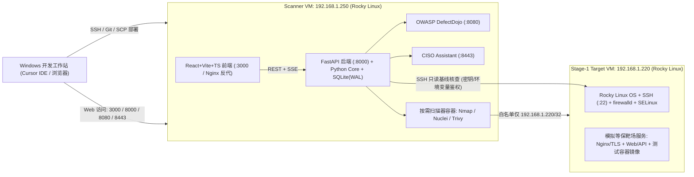

# 等保三级扫描与报告系统详细实施计划（双平台 + LiteLLM 混合网关版）

> **文档版本**：v1.3（React + Vite + TypeScript + FastAPI + SQLite 前后端分离架构 + Enterprise SDF 视觉 + Rocky Linux 双 VM）  
> **适用标准**：《信息安全技术 网络安全等级保护基本要求》（GB/T 22239-2019）第三级（通用要求 + 云计算安全扩展要求）  
> **核心底座**：React + Vite + TypeScript（前端） / FastAPI + SQLite + LiteLLM（后端） / OWASP DefectDojo + CISO Assistant（安全与合规双底座）  
> **Stage 1 实验拓扑**：Scanner VM（Rocky Linux `192.168.1.250`）-> Target VM（Rocky Linux `192.168.1.220`）  
> **配套文档**：[UI_UX设计规范.md](./UI_UX设计规范.md)  
> **预计周期**：6 周（覆盖 Stage 1 本地靶机 -> Stage 2 公司 IT -> Stage 3 移动云跨境平台）

---

## 1. 项目定位、目标与合规红线

### 1.1 系统定位
这套系统用来做等保三级的差距自查。扫描和基线先把技术证据收进来，再对照条款整理差距，并跟踪整改。正式测评报告仍由具备资质的机构出具，这里给出的是进场之前可以核对的材料。

自动化能覆盖的是有直接证据的技术项，大约 35% 到 45% 可以形成较确定的意见，另有约 20% 到 25% 只能作为辅助证据。机房、云租户责任证明、22 类管理制度、人员岗位、商用密码应用、日志留存和应急演练这些内容，要等现场记录或文件补上之后，再由人工写出结论。

### 1.2 分阶段演进目标
1. **Stage 1（第 1~4 周，本地靶机 VM 闭环）**：搭通双开源平台底座、等保三级条款库、基础扫描和基线采集、保拓扑脱敏、模型双轨评审、CISO Assistant 同步，以及 PDF/HTML 差距报告。
2. **Stage 2（第 5 周，公司内部 IT 接入）**：补上容器与 Web 扫描，并在内网测试网段改用国内或私有化模型，同时把跨工具去重和误报名单调清楚。
3. **Stage 3（第 6 周，移动云与跨境业务扩展）**：补上移动云只读配置采集，接入 godlp 与 Akto 的导入结果，完成一次生产级预评估并交付报告。

### 1.3 三条工程约束
1. **数据出境**：涉敏和生产数据若要调用模型，先看资产密级。密级不允许出境时，请求留在国内或本地通道。跨境通道用在测试环境或已经批准的跨境场景，并且要经过指定代理。路由不符合密级时，代码直接中止这次调用。
2. **扫描范围**：目标以 `targets.yaml` 的白名单为准。名单之外的地址不会发出探测。只读核查和主动扫描分开配置，并带有并发、速率和超时限制。
3. **人工条款**：标记为仅人工核查的条款，默认停在待人工。证据还没到的时候，模型不把它们写成符合。

---

## 2. 总体系统架构与技术栈选型

### 2.1 四层架构与数据流图



### 2.2 技术栈选型与职责分工

| 层级 | 组件 / 技术 | 核心职责 | 选型理由 |
| :--- | :--- | :--- | :--- |
| **前端控制面** | **React 18 + Vite + TypeScript + Tailwind CSS + Lucide Icons** | Enterprise SDF 经典红白工作台、三主题切换、Ctrl+K 全局检索、双栏脱敏 Diff 审计、SSE 实时扫描流 | 像素级还原瑞士工业网格 UI/UX，强类型契约与组件化生态远优于低代码框架 |
| **后端 API 服务** | **Python 3.11+ (uv) + FastAPI + Uvicorn** | 提供 REST API、SSE 任务实时进度推送、JWT + `bcrypt` 鉴权，并编排核心扫描/脱敏/AI 引擎 | 原生衔接 Python 安全/LLM 生态，异步高性能，自动生成 OpenAPI 文档供 TS 类型同步 |
| **本地数据库** | **SQLite（WAL 模式）** + `database/db_manager.py` | 存储用户鉴权、资产与扫描任务、正向基线证据、加密脱敏映射、AI 条款评审与成本日志 | 零独立数据库运维负担，开启 WAL 并发模式足以支撑中小规模等保预评估团队高并发读写 |
| **漏洞管理底座** | OWASP DefectDojo (Docker) | 接收 Nmap/Nuclei/Trivy/Kubescape/ZAP 原始报告、资产分组、历史整改状态追踪 | 避免手写大量扫描器 XML/JSON 解析器，内置漏洞生命周期管理 |
| **合规 GRC 底座** | CISO Assistant (Docker) | 承载自定义 GB/T 22239-2019 框架、展示条款达标率、收集人工管理制度与云资质证据 | 专业合规审计工作流，补足纯漏洞平台在管理域和证据归档上的短板 |
| **LLM 统一网关** | LiteLLM (`completion` / `acompletion`) | 屏蔽底层模型差异，通过配置实现 Gemini 付费层与国内/私有化模型双轨路由 | 模型可以替换。国内等保项目需要数据留在境内时，切换到国内或本地通道即可 |
| **数据校验与脱敏** | Pydantic v2 + `cryptography` (Fernet) | 校验 LLM 输出 JSON 与 API 入参；加密保存保拓扑脱敏映射 | 模型输出格式不对时先拦住，本地映射字典留在本机 |
| **报告渲染引擎** | Jinja2 + WeasyPrint | 渲染与前端同源风格的《等保三级预评估差距报告》（HTML/PDF/Markdown）与整改工单 | 支持精细中文排版、红白网格样式、目录页眉与打印级 PDF 导出 |
| **容器与交付** | Docker Engine CE + Docker Compose v2 | 隔离双平台底座、前后端服务与按需启停的扫描器容器 | 环境可复现，适配 Rocky Linux 生产级部署 |

### 2.3 Stage 1 真实物理/VM 部署拓扑（Rocky Linux 双节点架构）

基于已就绪的两台本地 **Rocky Linux** 虚拟机，Stage 1 采用“**Windows 开发工作站 + Scanner 底座机 + Stage-1 Target 靶机**”三节点隔离拓扑：



#### Rocky Linux 环境专属工程要点（必须提前处理）
1. **容器引擎切换**：Rocky Linux 默认预装 `podman` / `buildah`，在 `192.168.1.250` 部署前需卸载冲突包并安装官方 **Docker CE + Docker Compose v2**，同时安装 **Node.js 20+ LTS（构建前端）** 与 **`uv`（Python 3.11+ 后端）**。
2. **SELinux 卷挂载标签**：Rocky Linux 默认开启 SELinux (`Enforcing`)。在 `infra/docker-compose.yml` 中，所有宿主机挂载目录（SQLite 数据目录、报告输出目录、DefectDojo 配置挂载）必须显式追加 `:Z` 或 `:z` 标签，否则容器启动时会出现 `Permission denied` 报错。
3. **防火墙精细放行（`firewalld`）**：在 `192.168.1.250` 上仅对局域网管理网段放行 `3000/tcp`（React 前端，生产可经 Nginx 统一反代 `/api` 至 `8000`）、`8000/tcp`（FastAPI 调试/OpenAPI，上线后可仅限本机回环）、`8080/tcp`（DefectDojo）、`8443/tcp`（CISO Assistant）。
4. **凭据与最小权限（口令留在本机环境变量）**：
   * 两台 VM 的初始 SSH 凭据写在 `192.168.1.250` 本地 `.env`（`STAGE1_TARGET_SSH_USER` / `STAGE1_TARGET_SSH_PASSWORD`）。代码、`targets.yaml` 和 Git 仓库里只保留变量名。
   * 第 1 周完成初始化后，优先在 `192.168.1.250` 生成 Ed25519 SSH 密钥对免密推送至 `192.168.1.220`，并在靶机上创建受限只读审计账号 `mlps_auditor`（仅授予 `sudoers` 只读核查命令白名单），用于验证生产级最小权限采集模式。
   * **靶机天然高危测试用例**：`192.168.1.220` 初始保留的“允许 root 远程密码登录 + 简单口令”状态，恰好可作为 Stage 1 验收时的必检高风险项，验证 `ssh_baseline.py` 与 AI 评审是否准确命中《GB/T 22239-2019》`8.1.4.1-a` 身份鉴别高风险判例。
5. **Stage-1 Target 模拟靶场构建（`192.168.1.220`）**：
   * 干净的操作系统无法验证 Web/容器/跨节点攻击路径，第 1 周需在 `192.168.1.220` 上部署一套轻量可控靶场（例如：弱 TLS 套件 Nginx 反向代理 + OWASP Juice Shop / DVWA 容器 + 含已知 CVE 的旧版基础镜像 + 刻意关闭的 `auditd` 或宽松安全配置），以便全面检验 Nmap、Nuclei、Trivy、SSH 基线与跨组件攻击路径推演效果。

---

## 3. 目标项目目录结构（前后端分离）

```text
等保三级扫描和报告系统/
├── .env.example                          # 环境变量模板（API Keys、Vault 加密密钥、JWT Secret、VM SSH/移动云只读凭据）
├── config/
│   ├── config.yaml                       # LiteLLM 模型路由矩阵、扫描器限速参数、DefectDojo/CISO 连接配置
│   ├── targets.yaml                      # 白名单资产清单、安全域归属、扫描模式锁
│   ├── mlps3_clauses.json                # GB/T 22239-2019 三级通用 + 云计算扩展指标库（供 AI 使用）
│   └── ciso_mlps3_framework.yaml         # CISO Assistant 自定义等保三级框架导入文件
├── infra/
│   ├── docker-compose.yml                # DefectDojo + CISO Assistant + 扫描器镜像 + 前后端部署编排（含 SELinux :Z）
│   ├── nginx.conf                        # 前端静态资源托管 + /api & /sse 反向代理至 FastAPI (:8000)
│   └── defectdojo_dedup_settings.py      # DefectDojo 自定义去重算法调优配置挂载文件
├── backend/                              # Python 3.11+ (uv) + FastAPI + SQLite 核心后端
│   ├── pyproject.toml                    # uv 依赖管理清单
│   ├── main.py                           # FastAPI 应用入口（CORS、全局异常处理、路由挂载、WAL 初始化）
│   ├── api/                              # REST API + SSE 路由层（SQL 写在 database/db_manager.py）
│   │   ├── deps.py                       # JWT 鉴权依赖、RBAC 角色校验与 DB 注入
│   │   ├── auth.py                       # /api/auth/login, /register, /me（bcrypt 哈希 + JWT）
│   │   ├── projects.py                   # /api/projects, /targets, /whitelist
│   │   ├── scans.py                      # /api/scans/run, /api/scans/{job_id}/stream (SSE 实时进度流)
│   │   ├── sanitization.py               # /api/sanitization/{job_id}/diff, /approve（人工放行闸门）
│   │   ├── compliance.py                 # /api/clauses, /assess, /attack-paths, /manual-evidence, /ciso-sync
│   │   └── reports.py                    # /api/reports/generate, /download（脱敏版/受控还原版 PDF & 工单）
│   ├── database/
│   │   ├── schema.sql                    # SQLite 完整表结构定义（WAL 模式 + 外键约束）
│   │   └── db_manager.py                 # 统一数据访问封装（所有 SQL 收敛在此层）
│   ├── core/
│   │   ├── models.py                     # Pydantic v2 核心模型（Evidence, ClauseAssessment, AttackPath）
│   │   ├── runner.py                     # 白名单校验、并发/限速锁、超时熔断与扫描调度器
│   │   ├── defectdojo_client.py          # DefectDojo REST API v2 客户端 + 二次聚合去重
│   │   ├── sanitizer.py                  # 保拓扑确定性可逆脱敏引擎 + 零泄漏前置断言
│   │   ├── llm_assessor.py               # LiteLLM 双轨路由评审引擎 + Gemini BLOCK_NONE 注入
│   │   ├── ciso_sync.py                  # CISO Assistant REST API 双向同步客户端
│   │   ├── report_generator.py           # 受控还原映射 + Jinja2/WeasyPrint 报告与工单生成器
│   │   └── collectors/
│   │       ├── ssh_baseline.py           # Rocky Linux 等保三级只读基线核查脚本（SSH 只读）
│   │       ├── ecloud_collector.py       # 中国移动云（eCloud）OpenAPI 只读配置采集器
│   │       └── external_adapters.py      # godlp 跨境抽检 & Akto API 越权适配器
│   ├── templates/
│   │   ├── gap_report.html.j2            # 视觉同源的经典红白等保三级差距报告 HTML/PDF 模板
│   │   └── remediation_tickets.md.j2     # 整改工单 Markdown 模板
│   └── tests/
│       ├── test_sanitizer_leakage.py     # 脱敏零泄漏与保拓扑可逆性单元测试
│       ├── test_whitelist_guard.py       # 白名单越界拦截与危险标签过滤测试
│       ├── test_llm_routing_guard.py     # 涉敏资产改走国内或本地通道的路由测试
│       └── test_dedup_aggregation.py     # 跨工具 CVE 二次聚合去重测试
└── frontend/                             # React 18 + Vite + TypeScript + Tailwind CSS 控制面
    ├── package.json
    ├── vite.config.ts                    # 开发态 /api -> http://192.168.1.250:8000 代理配置
    ├── tsconfig.json
    ├── tailwind.config.ts
    └── src/
        ├── main.tsx
        ├── App.tsx                       # React Router 路由与受保护鉴权壳
        ├── styles/
        │   └── tokens.css                # 经典红白 / 极地蓝白 / 暗夜深空三主题 CSS 变量、24px 网格与斜纹样式
        ├── types/
        │   └── api.ts                    # 与 FastAPI Pydantic Schema 对齐的 TypeScript 强类型定义
        ├── api/
        │   ├── client.ts                 # Axios/Fetch 统一客户端（Token 拦截、错误 Toast、SSE 封装）
        │   └── hooks.ts                  # TanStack Query 数据请求与缓存 Hooks
        ├── store/
        │   └── useAppStore.ts            # Zustand 全局状态（当前主题、登录用户、当前选中评估项目、Ctrl+K 开关）
        ├── components/
        │   ├── layout/
        │   │   ├── WorkbenchShell.tsx    # 左侧固定窄栏（菜单/搜索/红色斜纹/三主题切换/用户卡）+ 主画布
        │   │   └── CommandPalette.tsx    # Ctrl+K 全局快速检索条款/资产/CVE 弹窗
        │   └── ui/
        │       ├── HazardStripe.tsx      # 标志性红色斜纹警戒分割条
        │       ├── WorkspaceHeader.tsx   # 项目摘要头卡片（眉标/标题/阶段红标/密级灰标）
        │       ├── MetadataStrip.tsx     # 4 列双语等宽眉标核心状态条
        │       ├── MetricsGrid.tsx       # 4 列等宽合规交付流 KPI 网格
        │       ├── StatusPill.tsx        # 统一状态胶囊组件
        │       └── SubNavTabs.tsx        # 二级水平胶囊导航栏
        └── pages/
            ├── LoginPage.tsx             # 左右双栏登录与能力宣导页（24px 方格底纹 + 3x2 能力矩阵）
            ├── GlobalDashboardPage.tsx   # 全局大盘与我的待办
            ├── WorkspacePage.tsx         # 评估项目主工作空间（挂载 10 个二级子视图）
            └── workspace/
                ├── OverviewTab.tsx       # 概览（状态条 / 评估时间线 / 合规交付流 / 交付制品）
                ├── AssetsWhitelistTab.tsx# 资产白名单与模式锁管理
                ├── ScanTasksTab.tsx      # 扫描采集调度与 SSE 实时进度流
                ├── EvidencesTab.tsx      # 漏洞去重明细与 Rocky Linux 基线正向/负向证据
                ├── SanitizationTab.tsx   # 脱敏前后双栏 Diff 对比与人工放行闸门
                ├── ClausesReviewTab.tsx  # AI 条款映射复核、加固命令复制与人工修正
                ├── AttackPathsTab.tsx    # 跨组件攻击路径 Mermaid 可视化与 Top 5 风险链
                ├── ManualEvidenceTab.tsx # 人工管理制度/云资质证据上传与 CISO Assistant 同步
                └── ReportsExportTab.tsx  # 报告预览、受控还原开关与 PDF/工单下载
```

---

## 4. 核心子系统详细技术设计

### 4.1 安全调度与防雪崩设计（`core/runner.py`）

#### 1. `config/targets.yaml` 结构规范（Stage 1 真实环境配置）
> Stage 1 白名单写成单主机 `/32`（`192.168.1.220/32`）。整个 `192.168.1.0/24` 先不放开，避免扫到宿主机、路由器或扫描机自身（`192.168.1.250`）。SSH 凭据只引用 `.env` 里的变量名。

```yaml
project:
  name: "Stage-1 本地靶机等保三级预评估"
  env_tier: "L1_TEST"              # L1_TEST | L2_INTERNAL | L3_CROSSBORDER
  llm_profile: "gemini_paid"       # Stage 1 可测 gemini_paid；Stage 2 强制切 domestic_cn / local_vllm

whitelist_cidrs:
  - "192.168.1.220/32"             # 单主机白名单，扫描范围不到 192.168.1.250 和局域网其他设备

forbidden_cidrs:
  - "192.168.1.250/32"             # 显式黑名单保护 Scanner 底座自身

global_limits:
  max_concurrency: 2               # 同一时刻最多并发执行的扫描任务数
  task_timeout_sec: 1800           # 单工具任务超时强制熔断时间（秒）
  nuclei_rate_limit: 50            # Nuclei 每秒最大请求数
  nuclei_exclude_tags:             # 强制剔除高危侵入式模板
    - "dos"
    - "fuzz"
    - "intrusive"
    - "bruteforce"

assets:
  - asset_id: "stage1-rocky-target-01"
    host: "192.168.1.220"
    security_zone: "DMZ"           # 保拓扑脱敏后对外映射为 ZONE_DMZ_HOST_01
    os_type: "rocky_linux"
    scan_mode: "READONLY_AUDIT"    # READONLY_AUDIT | ACTIVE_SCAN
    ssh_config:
      port: 22
      user_env: "STAGE1_TARGET_SSH_USER"
      auth_mode: "key_or_password_env"     # 优先密钥 STAGE1_TARGET_SSH_KEY_PATH，回退 STAGE1_TARGET_SSH_PASSWORD
    scanners: ["nmap", "nuclei", "trivy", "ssh_baseline"]
```

#### 2. 四项扫描约束
* **白名单校验**：启动扫描容器之前，先解析目标 IP 或域名，再和 `whitelist_cidrs` 比对。没有命中就结束这次任务，并写入安全审计日志。
* **模式分开**：`READONLY_AUDIT` 使用基线和模板检查。ZAP Active Scan、OpenVAS 侵入式脚本以及 Nuclei 的非只读模板，要等切换到主动扫描之后再启用。
* **资源与超时熔断**：通过 `docker run --memory=2g --cpus=1.5` 限制扫描器容器资源，超出 `task_timeout_sec` 自动 `docker kill` 回收。
* **只读凭据原则**：SSH 基线采集与移动云采集器仅允许配置只读账号/只读策略权限（如移动云只读 IAM Policy）。

---

### 4.2 多源数据采集与双轨归一化策略

#### 1. 漏洞类工具接入与 DefectDojo 二次去重（`core/defectdojo_client.py`）
* **原生导入**：Nmap（XML）、Nuclei（JSON）、Trivy（JSON）、Kubescape（JSON）、OWASP ZAP（XML/JSON）均通过 DefectDojo `/api/v2/import-scan/` 推送。
* **弥补 DefectDojo 去重短板**：
  * 在 `infra/defectdojo_dedup_settings.py` 中为上述 Parser 显式配置精确的哈希去重字段组合。
  * 从 DefectDojo 拉取 `active=true&duplicate=false` 的 Finding 后，在 `defectdojo_client.py` 中执行一次确定性的**跨工具二次聚合**：
    * 若存在 CVE 编号，按 `(asset_id, cve_id, port_or_component)` 合并；
    * 若无 CVE 但存在 CWE + 同端口/同路径，按 `(asset_id, cwe_id, endpoint_path)` 合并；
    * 合并后保留 `detected_by: ["trivy", "nuclei"]` 交叉验证标记，既降低 Token 消耗，又提升置信度。

#### 2. Rocky Linux (RHEL 8/9 系) 等保三级只读基线采集器（`core/collectors/ssh_baseline.py`）
针对 Stage 1 靶机及企业常见 RHEL/Rocky Linux 服务器，精准按《GB/T 22239-2019》安全计算环境要求编写只读 SSH 命令集，输出**正向与负向双向合规证据**直入 SQLite：
* **身份鉴别**：
  * `/etc/login.defs`（口令最长有效期 `PASS_MAX_DAYS`、最小长度 `PASS_MIN_LEN`）
  * `/etc/security/pwquality.conf`（口令复杂度 `minlen`、`minclass`、`dcredit`/`ucredit`/`lcredit`/`ocredit`）
  * `authselect current` 与 `/etc/security/faillock.conf` / `/etc/pam.d/system-auth`（登录失败锁定次数与解锁时间）
  * `/etc/ssh/sshd_config`（`PermitRootLogin`、`Protocol`、`ClientAliveInterval` 空闲超时、`MaxAuthTries`）
  * 空口令账号与非 `root` 的 UID 0 账号检查
* **访问控制与强制访问控制（MAC）**：
  * **SELinux 状态核查**：`getenforce` 与 `/etc/selinux/config`（等保三级强制访问控制加分/关键项）
  * 敏感文件权限（`/etc/passwd`、`/etc/shadow`、`/etc/group`、`/etc/gshadow`、`/etc/sudoers`）、`umask` 默认值（`/etc/profile`、`/etc/bashrc`）、异常 SUID/SGID 文件核查
* **安全审计与时间同步**：
  * `systemctl is-active auditd rsyslog chronyd`（审计服务、日志服务与 NTP 时间同步状态）
  * `auditctl -l` 与 `/etc/audit/rules.d/` 关键审计规则覆盖度
  * `/etc/logrotate.conf` 与 `/etc/rsyslog.conf`（核查日志留存周期是否满足 180 天或已配置外发集中日志服务器）
* **入侵防范、边界与安全补丁**：
  * `firewall-cmd --state` 与 `firewall-cmd --list-all`（Rocky Linux `firewalld` 策略核查）
  * `ss -tulnp` 最小化监听端口与无用服务清单
  * `sysctl` 关键网络加固参数（`net.ipv4.tcp_syncookies`、`net.ipv4.conf.all.accept_redirects` 等）
  * `dnf check-update --security`（检测 Rocky Linux 未安装的 RLSA 高危安全补丁）及 `testssl.sh` TLS 套件强度检查

#### 3. 移动云（eCloud）OpenAPI 只读采集器（`core/collectors/ecloud_collector.py`）
针对主流开源 CSPM 不支持移动云的现状，第 6 周独立开发只读采集插件，重点采集并映射到等保三级云计算扩展要求：
* **IAM 与权限**：主账号是否启用 MFA、是否存在长期未轮换 AK/SK、是否存在全通 `*:*` 过高权限策略。
* **网络与边界**：VPC 安全组是否存在高危端口（22/3389/3306/6379/9200）对 `0.0.0.0/0` 开放、云防火墙与 WAF 策略启用状态。
* **日志与数据保护**：云操作审计（CloudTrail 等效服务）是否开启且覆盖全地域、对象存储桶（EOS）公共读写 ACL 检查、云盘/数据库加密与 KMS 密钥配置、快照与跨区备份策略。

#### 4. 跨境与 API 扩展适配器（`core/collectors/external_adapters.py`）
* **`godlp` 适配器**：解析跨境传输样本的敏感数据识别率、脱敏覆盖字段、未脱敏泄漏样例统计（仅保留脱敏后的类型与数量统计，不落盘原始明文）。
* **`Akto` 适配器**：解析 API 资产清单、未鉴权接口、BOLA/IDOR 越权告警，转化为标准 `NormalizedEvidence`。

---

### 4.3 《GB/T 22239-2019》三级指标库与 CISO Assistant 集成

#### 1. 结构化条款库 Schema（`config/mlps3_clauses.json`）
每条等保三级指标定义为标准对象：
```json
{
  "clause_id": "8.1.4.1-a",
  "domain": "安全计算环境",
  "control_point": "身份鉴别",
  "requirement_text": "应对登录的用户进行身份标识和鉴别，身份标识具有唯一性，身份鉴别信息具有复杂度要求并定期更换。",
  "extension_type": "GENERAL",
  "auto_level": "FULL_AUTO",
  "high_risk": true,
  "expected_evidence_sources": ["ssh_baseline", "ecloud_iam", "nuclei"],
  "manual_check_guide": "核查应用系统层及数据库层是否存在弱口令与口令定期更换策略。"
}
```
* `auto_level` 枚举值严格控制报告真实性：
  * `FULL_AUTO`：技术工具可给出确凿判定；
  * `PARTIAL_EVIDENCE`：工具提供技术侧证据，必须附带人工复核提示；
  * `MANUAL_ONLY`：管理制度/物理环境/组织人员类条款，AI 仅生成访谈核查清单，状态锁定为 `PENDING_MANUAL`，由安全人员在 CISO Assistant 或 Streamlit 页面上传证据后变更状态。

#### 2. CISO Assistant 集成方式（`core/ciso_sync.py`）
* 第 1 周将 `mlps3_clauses.json` 转换为 CISO Assistant 兼容的 `ciso_mlps3_framework.yaml` 导入，建立标准评估项目（Compliance Assessment）。
* 每次评估完成后，`ciso_sync.py` 调用 CISO Assistant REST API 增量回写技术类条款状态（`compliant` / `partially_compliant` / `non_compliant` / `not_assessed`）与脱敏证据摘要；同时拉取人工在 CISO Assistant 中填写的管理制度评估结论，合并生成完整预评估报告。

---

### 4.4 保拓扑可逆脱敏引擎（`core/sanitizer.py`）

#### 1. 保拓扑确定性映射规则
为解决“随机脱敏破坏跨节点攻击路径推演”的矛盾，按资产归属安全域生成确定性代号：
* 内网 IP：按 `targets.yaml` 安全域映射，例如 `10.10.1.15 -> ZONE_DMZ_HOST_01`、`10.10.2.20 -> ZONE_APP_HOST_01`、`10.10.3.10 -> ZONE_DB_HOST_01`；未知网段映射为 `ZONE_EXT_IP_01`。
* 域名与主机名：`api.corp.internal -> DOMAIN_INT_01`、`crossborder.example.com -> DOMAIN_EXT_01`。
* 账号与实体：真实用户名、数据库名、桶名称映射为 `USER_01`、`DB_01`、`BUCKET_01`。

#### 2. 深度净化与零泄漏前置检查（Pre-flight Leak Check）
* **HTTP 报文裁剪**：对于 ZAP / Nuclei 捕获的 HTTP Request/Response，只保留方法、脱敏后路径模板、状态码与漏洞特征摘要；**强制丢弃** `Authorization`、`Cookie`、`Set-Cookie`、`X-API-Key` 及完整响应正文。
* **敏感模式擦除**：正则 + 高熵字符串检测，强替换 AK/SK、Bearer JWT、私钥头（`-----BEGIN ... KEY-----`）、手机号、身份证号、邮箱。
* **本地加密 Vault**：映射字典使用 `cryptography.fernet` 加密后存入 SQLite `sanitization_vault` 表。加密主密钥只从 `.env` 读取，不写入数据库，也不写入代码。
* **零泄漏断言**：所有 Payload 在发往 `llm_assessor.py` 之前，必须通过正则回扫检查（确认不包含任何真实白名单内网 IP、明文密钥或未脱敏敏感字段），命中则立即熔断拒绝发送。

---

### 4.5 LiteLLM 双轨合规网关与 AI 评审引擎（`core/llm_assessor.py`）

#### 1. 模型路由配置示例（`config/config.yaml`）
```yaml
llm_profiles:
  gemini_paid:
    allowed_env_tiers: ["L1_TEST", "L3_CROSSBORDER_APPROVED"]
    is_cross_border: true
    fast_mapper_model: "gemini/gemini-4-hydrogen"   # 模型 ID 从配置读取
    deep_reasoner_model: "gemini/gemini-4-neon"     # 或 gemini/gemini-4-carbon
    enable_context_caching: true
    inject_block_none_safety: true

  domestic_cn:
    allowed_env_tiers: ["L1_TEST", "L2_INTERNAL", "L3_CROSSBORDER"]
    is_cross_border: false
    fast_mapper_model: "deepseek/deepseek-chat"
    deep_reasoner_model: "deepseek/deepseek-reasoner"
    enable_context_caching: false
    inject_block_none_safety: false

  local_vllm:
    allowed_env_tiers: ["L1_TEST", "L2_INTERNAL", "L3_CROSSBORDER"]
    is_cross_border: false
    api_base: "http://10.10.99.50:8000/v1"
    fast_mapper_model: "openai/qwen-32b-instruct"
    deep_reasoner_model: "openai/qwen-72b-instruct"
    enable_context_caching: false
    inject_block_none_safety: false
```

#### 2. 关键实现规范
* **合规拦截守卫**：调用前比对 `targets.yaml` 的 `env_tier` 与所选 `llm_profile.allowed_env_tiers`，不匹配直接抛出 `CompliancePolicyError`。
* **统一调用接口**：全部使用 `litellm.completion` / `litellm.acompletion`，密钥全部通过 `os.environ.get` 从 `.env` 读取。
* **Gemini 裁判/安全分析防拒答配置（CRITICAL）**：当 `inject_block_none_safety: true` 且模型为 Gemini 系列时，必须在请求参数中强制注入：
  ```python
  safety_settings = [
      {"category": "HARM_CATEGORY_HARASSMENT", "threshold": "BLOCK_NONE"},
      {"category": "HARM_CATEGORY_HATE_SPEECH", "threshold": "BLOCK_NONE"},
      {"category": "HARM_CATEGORY_SEXUALLY_EXPLICIT", "threshold": "BLOCK_NONE"},
      {"category": "HARM_CATEGORY_DANGEROUS_CONTENT", "threshold": "BLOCK_NONE"},
  ]
  ```
* **两阶段分域推理架构（避免 1M 上下文注意力退化）**：
  1. **阶段 A（分域条款映射，高速低价模型）**：将脱敏后的证据按“安全通信网络 / 安全区域边界 / 安全计算环境 / 云计算扩展”拆分为 4 个独立批次，携带对应域的条款列表，要求模型严格输出 Pydantic 校验的 JSON（含 `clause_id`、`status`、`risk_level`、`evidence_ids`、`gap_summary`、`remediation_script`、`needs_manual_verify`）。
  2. **阶段 B（全局攻击路径推演与综合研判，强推理模型）**：仅输入阶段 A 筛出的中/高危缺陷摘要 + 保拓扑安全域关系图，推演跨组件攻击链（例如“DMZ Web 未授权 -> SSRF 探测内网 -> APP 容器提权 -> 访问 DB”），输出 Top 5 优先整改路径与可执行的加固命令/补丁建议。

---

### 4.6 SQLite 数据库表结构设计（`backend/database/schema.sql`）

SQLite 初始化时强制启用 WAL 并发日志模式与外键约束（`PRAGMA journal_mode=WAL; PRAGMA synchronous=NORMAL; PRAGMA foreign_keys=ON;`），确保 FastAPI 异步读写与后台扫描器落库不发生锁表阻塞。所有 SQL 操作严格封装在 `backend/database/db_manager.py`：
* `scan_jobs`：`job_id`、`project_name`、`env_tier`、`llm_profile`、`status`、`progress_pct`、`current_stage`、`started_at`、`finished_at`、`error_msg`
* `assets`：`asset_id`、`host_masked`、`security_zone`、`os_type`、`scan_mode`、`created_at`
* `normalized_evidences`：`evidence_id`、`job_id`、`asset_id`、`source_tool`（defectdojo / ssh_baseline / ecloud / godlp / akto）、`evidence_type`（VULNERABILITY / BASELINE_PASS / BASELINE_FAIL / CLOUD_CONFIG）、`severity`、`cve_or_cwe`、`title`、`sanitized_detail_json`、`detected_by_json`
* `clause_assessments`：`assessment_id`、`job_id`、`clause_id`、`auto_status`、`manual_status`、`final_status`、`risk_level`、`is_high_risk`、`evidence_ids_json`、`ai_rationale`、`remediation_script`、`reviewer`、`reviewed_at`
* `attack_paths`：`path_id`、`job_id`、`title`、`severity`、`steps_json`、`mitigation_priority`
* `sanitization_vault`：`vault_id`、`job_id`、`encrypted_mapping_blob`、`leak_check_passed`、`approved_by`、`approved_at`、`created_at`
* `llm_audit_logs`：`log_id`、`job_id`、`stage`、`model_id`、`prompt_tokens`、`completion_tokens`、`cached_tokens`、`latency_ms`、`status`、`error_detail`
* `users`：`user_id`、`email`、`password_hash`（强制使用 `bcrypt` 哈希）、`role`（admin / security_lead / auditor）、`theme_preference`（`classic_red` / `arctic_blue` / `midnight_dark`）、`created_at`

---

### 4.7 React + Vite + TypeScript 企业级控制面与 FastAPI 契约设计

> 完整的视觉变量（Design Tokens）、线框图、Tailwind/CSS 实现及各子页交互细节详见配套文档 **[UI_UX设计规范.md](./UI_UX设计规范.md)**。

#### 1. 前端架构与 Enterprise SDF 经典红白交互体验
* **视觉体系**：采用瑞士精密工业网格风，大面积冷白画布（`#F7F8FA`）+ 纯白 1px 线框卡片（`#FFFFFF` / `#E5E7EB`）+ 品牌警戒红（`#D91E2A`）锚点，配合标志性**红色斜纹警戒分割条**与**双语等宽微型眉标**（如 `PII REDACTION · 敏感脱敏`、`LIFECYCLE · 评估阶段`、`COMPLIANCE FLOW METRICS`）。
* **三主题零闪烁切换**：通过 `frontend/src/styles/tokens.css` 的 `[data-theme="classic_red|arctic_blue|midnight_dark"]` 变量与 `Zustand` 持久化状态，实现经典红白（默认）/ 极地蓝白 / 暗夜深空一键切换，并同步回写后端 `users.theme_preference`。
* **左右双栏登录工作台（`LoginPage.tsx`）**：左侧为 24px 浅灰工程方格底纹 + 红色斜纹分割条 + 3×2 能力矩阵；右侧为企业邮箱与口令登录卡片（对接 `/api/auth/login`，`bcrypt` + JWT 鉴权）+ 满宽正红主按钮。
* **工作空间外壳与核心交互（`WorkbenchShell.tsx` + `WorkspacePage.tsx`）**：
  * **左侧固定窄导航栏（236px）**：集成 `Ctrl+K` 全局命令面板检索条款/资产/CVE、淡红激活态胶囊菜单、底部红色警戒斜纹、三主题切换器与用户角色卡片。
  * **右侧评估项目工作空间**：顶部项目摘要头卡片（红底阶段徽章 + 灰框密级徽章）+ 二级水平胶囊标签栏（`概览` / `资产白名单` / `扫描采集` / `漏洞与基线` / `脱敏审计` / `AI 条款映射` / `攻击路径` / `人工证据` / `报告制品` / `设置`）+ 4 列双语眉标状态条 + 评估版本时间线 + 4 列等宽合规交付流 KPI 网格 + 交付制品卡。
  * **SSE 实时进度与双栏 Diff 审计**：扫描采集与 AI 评审通过 `EventSource` 订阅 FastAPI SSE 流实时刷新步骤耗时与日志；脱敏审计页采用左右双栏 Diff 视图高亮 `ZONE_DMZ_HOST_01` 映射并支持人工一键放行。

#### 2. FastAPI 核心接口契约清单（`backend/api/`）
* `POST /api/auth/login`、`GET /api/auth/me`、`PATCH /api/auth/theme`：认证、角色信息与主题持久化。
* `GET /api/projects/{id}/overview`、`GET /api/projects/{id}/targets`：拉取工作空间摘要、合规交付流指标、白名单资产与扫描模式锁。
* `POST /api/scans/run`、`GET /api/scans/{job_id}/stream`（SSE）：触发扫描任务（触发白名单硬校验）并流式推送扫描与去重实时进度。
* `GET /api/evidences/{job_id}`：按来源/严重度/去重状态分页查询 DefectDojo 二次聚合漏洞与 Rocky Linux 基线正向/负向证据。
* `GET /api/sanitization/{job_id}/diff`、`POST /api/sanitization/{job_id}/approve`：查看脱敏前后对照和零泄漏检查结果。人工确认之后，才开始 LLM 评审。
* `POST /api/compliance/{job_id}/assess`、`GET /api/compliance/{job_id}/clauses`、`PATCH /api/compliance/clauses/{assessment_id}`：触发 LiteLLM 分域评审、查询条款映射结果与人工复核修改。
* `GET /api/compliance/{job_id}/attack-paths`、`POST /api/compliance/{job_id}/ciso-sync`：获取跨组件攻击路径与触发 CISO Assistant 双向同步。
* `POST /api/reports/{job_id}/generate`、`GET /api/reports/{report_id}/download`：生成并下载脱敏版/受控还原版 PDF 报告与 Markdown 整改工单。

#### 3. 视觉同源的《等保三级预评估差距报告》（Jinja2 + WeasyPrint）
`backend/templates/gap_report.html.j2` 复用同一套经典红白瑞士网格 Design Tokens（白色纸面 + 1px 网格表 + 红色斜纹章眉 + 红/灰状态胶囊），报告包含 7 个标准章节：
1. 评估范围、系统定级与自动化覆盖率说明（明确区分自动化项与人工核查项）
2. 执行摘要与高风险项（可能直接导致测评不通过的项）清单
3. 各安全域合规达标率统计（安全通信网络 / 区域边界 / 计算环境 / 管理中心 / 云计算扩展 / 安全管理域）
4. 跨组件攻击路径推演与关键风险链分析
5. 逐条等保三级差距明细、技术证据与可执行加固命令/Patch
6. 待人工核查与管理制度补充清单
7. 按优先级（P0/P1/P2）排列的整改工单排期表

---

## 5. 6 周详细实施排期（WBS）

### 第 1 周：Rocky Linux 双 VM 环境初始化、双平台底座搭建 + 前后端脚手架与条款库工程化
* **核心任务**：
  1. **Scanner VM（`192.168.1.250`）初始化**：卸载冲突的 `podman`、安装 Docker CE + Compose v2、Node.js 20+ LTS 与 `uv`（Python 3.11+）；用 `firewalld` 对内网管理端口放行 3000/8000/8080/8443；生成 Ed25519 SSH 密钥连通 `192.168.1.220`，初始凭据写入本地 `.env`。
  2. **Stage-1 Target VM（`192.168.1.220`）模拟靶场初始化**：在靶机上部署轻量级等保测试靶场（弱 TLS Nginx + 模拟 Web/API 靶场容器 + 含已知 CVE 的旧版测试镜像 + 可控基线缺陷），并额外创建低权限只读账号 `mlps_auditor` 用于对比验证。
  3. 编写 `infra/docker-compose.yml`（所有挂载卷严格加注 Rocky SELinux `:Z` 标签），在 `192.168.1.250` 上拉起 DefectDojo、CISO Assistant 及 Nmap/Nuclei/Trivy 镜像，配置独立 Docker 网段与内存限额，初始化 DefectDojo API v2 Token 与 `infra/defectdojo_dedup_settings.py`。
  4. 整理《GB/T 22239-2019》三级核心条款库（含云计算安全扩展），生成 `config/mlps3_clauses.json` 与 `config/ciso_mlps3_framework.yaml`，导入 CISO Assistant 验证结构完整。
  5. 初始化前后端工程骨架：`backend/`（FastAPI + SQLite WAL `schema.sql` + `db_manager.py` + `bcrypt`/JWT 登录接口）与 `frontend/`（React + Vite + TypeScript + Tailwind CSS + `tokens.css` 三套主题变量 + 双栏登录页骨架）。
* **本周交付物**：初始化完成的 Rocky Linux 双 VM（`192.168.1.250` 底座 + `192.168.1.220` 模拟靶场）、DefectDojo（`:8080`）与 CISO Assistant（`:8443`）、已导入等保三级框架的评估模板、可跑通登录鉴权的 React + FastAPI + SQLite 骨架。
* **验收标准**：Windows 开发机可通过浏览器访问 `http://192.168.1.250:3000` 完成经典红白登录页认证并切换三套主题；SELinux `Enforcing` 模式下容器挂载零权限错误；等保三级指标库覆盖 10 个核心域及云计算扩展要求。

### 第 2 周：安全调度器、DefectDojo 归一化与 Rocky Linux 基线采集闭环
* **核心任务**：
  1. 开发 `backend/core/runner.py`：完成白名单校验（范围是 `192.168.1.220/32`，并排除 `192.168.1.250/32`）、并发信号量、超时熔断、Nuclei 危险标签剔除及 Docker 容器化调度。
  2. 开发 `backend/core/defectdojo_client.py`：实现 Nmap/Nuclei/Trivy 报告自动导入、产品/任务创建与拉取时的二次 `(Asset, CVE/CWE)` 聚合去重。
  3. 开发 `backend/core/collectors/ssh_baseline.py`：实现 Rocky Linux 专属等保三级只读基线采集（含 SELinux、`pwquality`、`pam_faillock`、`firewalld`、`auditd`、`chronyd`、`dnf --security`）并落库 SQLite。
  4. 开发 FastAPI `/api/scans/run`、SSE 实时进度流 `/api/scans/{job_id}/stream` 与 `/api/evidences/{job_id}`，同步编写 `test_whitelist_guard.py` 与 `test_dedup_aggregation.py`。
* **本周交付物**：在 `192.168.1.250` 上可经由 API 一键对 `192.168.1.220` 执行扫描、实时推送 SSE 进度、基线采集与去重入库的后端管线。
* **验收标准**：对 `192.168.1.250` 或 `192.168.1.1` 发起扫描时，探测包数量为 0；靶机同一 CVE 经多工具扫描后在本地证据表中聚合成 1 条，并保留多源标记；SSH 基线能记下靶机的 `PermitRootLogin`、弱口令、SELinux 和补丁状态，且不修改靶机。

### 第 3 周：保拓扑脱敏与 LiteLLM 双轨评审引擎
* **核心任务**：
  1. 开发 `backend/core/sanitizer.py`：实现安全域确定性映射（如 `192.168.1.220 -> ZONE_DMZ_HOST_01`）、HTTP 敏感头与响应正文裁剪、密钥和 PII 清除、本地 Fernet 加密库与零泄漏前置检查，并提供 `/api/sanitization/{job_id}/diff` 与 `/approve`。
  2. 开发 `backend/core/llm_assessor.py`：按 `config/config.yaml` 的路由策略调用模型，按资产密级选择通道，为 Gemini 注入 `BLOCK_NONE`，配置 Context Caching，做分域映射和攻击路径整理，并提供 `/api/compliance/{job_id}/assess` 等接口。
  3. 编写 `test_sanitizer_leakage.py` 与 `test_llm_routing_guard.py`。
* **本周交付物**：完整的脱敏引擎与双轨 AI 评审后端服务（含单元测试与 Token/耗时审计入库）。
* **验收标准**：`L2_INTERNAL` 资产尝试走 `gemini_paid` 100% 触发 `CompliancePolicyError`；脱敏回归测试集漏脱率为 0；Gemini 通道分析高危漏洞与攻击路径零 Safety Filter 拒答；输出 100% 通过 Pydantic JSON Schema 校验。

### 第 4 周：CISO 双向同步、React Enterprise SDF 完整控制面与 Stage 1 验收
* **核心任务**：
  1. 开发 `backend/core/ciso_sync.py` 与 `backend/core/report_generator.py`（配合 `gap_report.html.j2` / `remediation_tickets.md.j2`），实现 CISO Assistant 双向同步、受控还原映射与 WeasyPrint 经典红白 PDF 导出接口。
  2. 严格依据 [UI_UX设计规范.md](./UI_UX设计规范.md) 完成 `frontend/src/` 全套 Enterprise SDF 工作台页面与组件（左侧固定导航 + `Ctrl+K` 全局命令面板 + 评估项目 10 个二级水平 Tabs：概览/白名单/SSE 扫描流/漏洞与基线/双栏脱敏 Diff 放行/AI 条款复核/Mermaid 攻击路径/人工证据上传/报告制品导出）。
  3. 配置 `infra/nginx.conf` 统一托管前端生产构建产物并反代 `/api` 与 SSE 流至 FastAPI。
  4. 针对 Stage 1 靶机（`192.168.1.220`）执行端到端验收，逐条核对 UI 交互、脱敏零泄漏、AI 条款映射准确率与 PDF 排版质量。
* **本周交付物**：Stage 1 完整可运行前后端分离 MVP（React + Vite + TS 控制面、FastAPI + SQLite 后端、双平台同步与 PDF 差距报告）。
* **验收标准**：浏览器端一键跑通“登录 -> 触发只读扫描（SSE 实时流）-> 双栏脱敏审查放行 -> AI 条款映射与攻击路径推演 -> 人工复核同步 CISO -> 导出 PDF 报告”全链路；三套主题切换零样式错位；技术类条款映射准确率 >= 85%，高风险项零漏报，`MANUAL_ONLY` 条款零 AI 编造“符合”。

### 第 5 周：Stage 2 公司 IT 接入与扫描器扩展
* **核心任务**：
  1. 接入 `Kubescape`（K8s 集群合规基线）与 `OWASP ZAP`（默认被动模式 + 授权后主动模式）；按测试环境资源评估是否以独立隔离队列接入 `OpenVAS`。
  2. 切换至**国内合规模型 / 私有化模型**通道，在公司内部 IT 测试网段试运行，并与 Gemini 通道在相同脱敏测试集上对比条款映射一致率与延迟。
  3. 建立企业级误报抑制规则（False Positive 白名单），优化 DefectDojo 去重参数。
* **本周交付物**：适配公司内网测试环境的 Stage 2 扩展版本与双轨模型对比评测记录。
* **验收标准**：国内/私有化模型通道全程零外网出境流量，业务无中断、无脏数据写入，报告获内部安全复核认可。

### 第 6 周：Stage 3 移动云与跨境插件及上线加固
* **核心任务**：
  1. 开发 `core/collectors/ecloud_collector.py`：对接移动云 OpenAPI（只读 AK/SK），采集 IAM、安全组、云防火墙、审计日志、对象存储 ACL 与加密配置，映射至等保三级云计算扩展条款。
  2. 开发 `core/collectors/external_adapters.py`：接入 `godlp` 跨境敏感数据抽检结果与 `Akto` API 越权检测结果。
  3. 执行上线前红蓝安全演练（白名单越界拦截、扫描超时熔断、脱敏泄漏拦截、涉敏模型路由拦截）并完善部署运维手册。
* **本周交付物**：覆盖本地主机、K8s、Web/API、移动云与跨境合规的全量系统 v1.0 及交付文档。
* **验收标准**：四组验收用例全部通过。移动云与跨境业务完成一次预评估，并产出差距报告和整改工单。

---

## 6. 风险登记簿与应对预案

| 风险项 | 风险等级 | 触发场景 | 应对与缓解预案 |
| :--- | :---: | :--- | :--- |
| **数据出境审批受阻** | 极高 | 安全合规要求公司资产数据留在境内 | 生产与内网使用 `domestic_cn` 或 `local_vllm`。测试环境的跨境调用另配代理，业务代码不用改 |
| **双平台内存与运维过重** | 高 | 测试机内存不足（<16GB）导致 DefectDojo/CISO OOM | 限制容器内存上限；将扫描器改为按需启停（ephemeral containers），不常驻后台；OpenVAS 延后并独立调度 |
| **移动云 OpenAPI 差异与限流** | 高 | 移动云接口分页、签名或区域差异导致采集失败 | 第 5 周末提前申请只读测试 AK/SK 并跑通 Demo；采集器内置指数退避重试与只读最小权限清单 |
| **DefectDojo 跨工具去重失准** | 中 | 同一漏洞被 Trivy/Nuclei 重复上报给 LLM | 在 `defectdojo_client.py` 增加确定性二次聚合层，按 `(Asset, CVE/CWE, Port)` 强制归并 |
| **主动扫描触发 WAF/业务告警** | 中 | ZAP/Nuclei 速率过高或命中侵入模板 | 默认只读模式；强制剔除 `dos/fuzz/intrusive` 标签；主动扫描前向运维报备并配置限速与测试窗口 |
| **LLM 幻觉或误判等保条款** | 中 | 长上下文漏看证据或将人工项判为符合 | 分安全域小批次推理 + Pydantic 强制要求引用 `evidence_ids` + `MANUAL_ONLY` 代码层硬锁定不可自动通过 + Streamlit 人工复核页兜底 |

---

## 7. 最终验收清单

1. **合规与隐私**
   * 代码库与配置文件中没有硬编码的 API Key、AK、SK 或数据库密码。
   * 涉敏资产若被指向境外模型通道，这次调用会中止并留下记录。
   * 脱敏前置检查对测试集中的内网 IP、JWT、Cookie、AK/SK、手机号、身份证号都能检出。
2. **扫描安全**
   * 对非白名单目标发出的探测包数量为 0。
   * 单任务超时之后，容器会被回收，不留下僵死进程。
3. **数据与准确率**
   * 跨工具重复 CVE 的聚合比例不低于 95%。
   * 自动化只对 `FULL_AUTO` 和 `PARTIAL_EVIDENCE` 给出建议。`MANUAL_ONLY` 进入人工复核队列。
4. **交付物**
   * 能同步 CISO Assistant，并生成中文字体正常、可在脱敏版和受控还原版之间切换的差距报告与整改工单。
